# Atom Neo Code Review Graph — 2026-11-10

> 配套文件：
> - [code-review-2026-11-10.md](./code-review-2026-11-10.md)
> - [code-review-plan-2026-11-10.md](./code-review-plan-2026-11-10.md)
>
> 图中 `CR-*` 为问题 ID；`S0–S12` 为计划阶段。

---

## 0. 图例

| 符号 | 含义 |
|---|---|
| 实线 | 直接依赖/调用 |
| 虚线 | 重复、隐式依赖或待删除 |
| 红色节点 | P0 正确性问题 |
| 橙色节点 | 高重复/高耦合 |
| 绿色节点 | 目标统一模块 |
| 灰色节点 | 禁区/暂不修改 |

---

## 1. 包与目录依赖

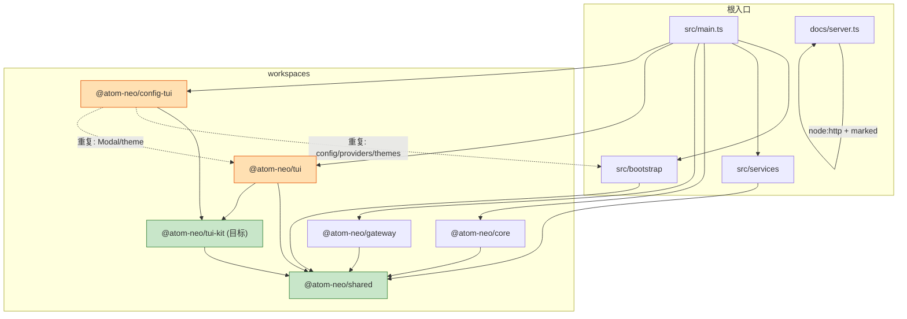

**结论**：
- 包边界总体正确；`config-tui` 与 `bootstrap`、`tui` 存在平行实现（虚线）。
- 目标新增 `@atom-neo/tui-kit`，让两个 UI 包只依赖它，不互相复制。

---

## 2. 运行时主流程

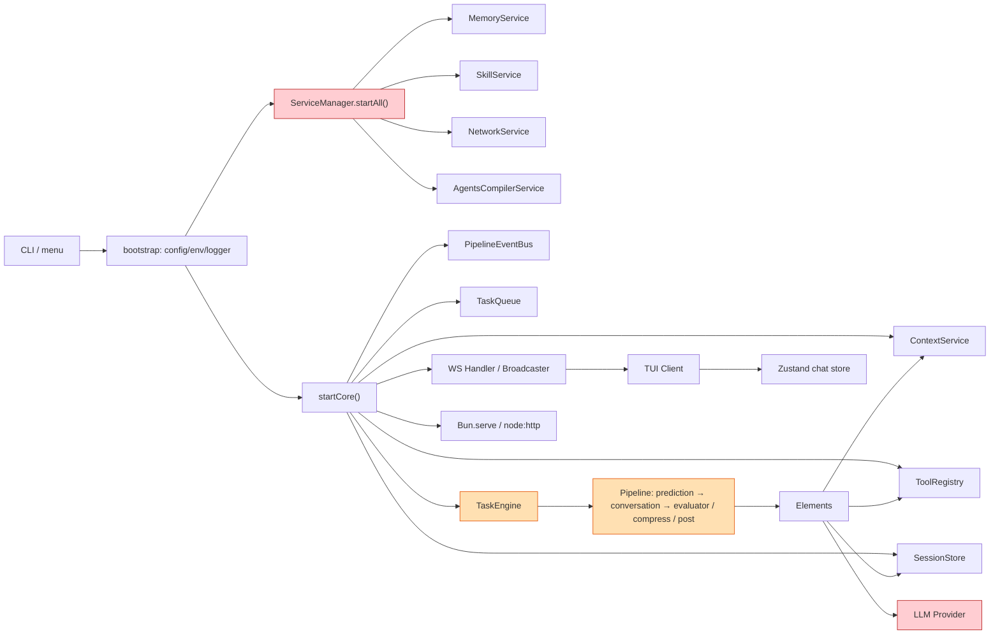

**风险点**：
- `ServiceManager.startAll()` 吞错（CR-COR-04），下游可能拿到 undefined。
- `TaskEngine` 事件重入与全局 pipeline map（CR-ARCH-02/08）。
- LLM 节点实际硬编码 DeepSeek（CR-PRO-01）。

---

## 3. 高影响文件与耦合热图

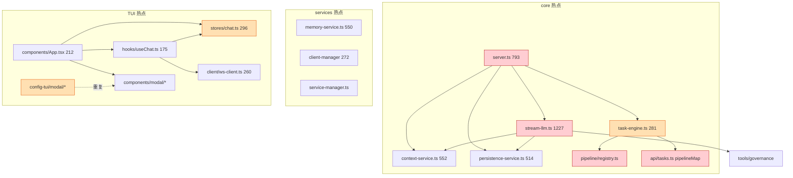

**读法**：
- 红色节点是 P0/P1 必须优先处理的结构点。
- `stream-llm` 同时连接 Context、Persistence、Tools，是最高耦合节点。
- `server.ts` 同时连接 Engine、Stream、Context、Persistence，是组合根/路由/生命周期的混合体。

---

## 4. 重复 → 统一模块

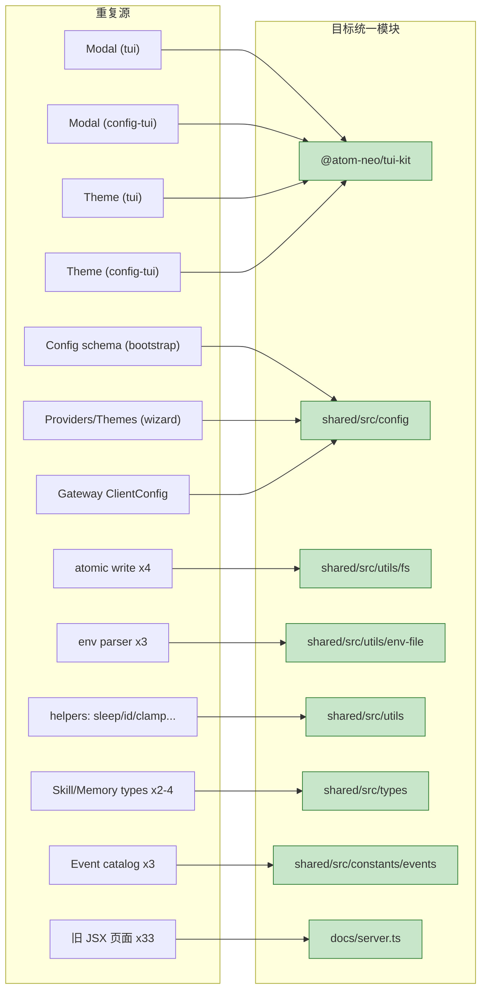

**迁移顺序**：
1. `shared` 基础工具（S3）
2. `tui-kit`（S5）
3. `shared` 类型（S3）
4. 事件目录（S6）
5. 删除旧 JSX 文档站（S4）

---

## 5. 事件流与重复源

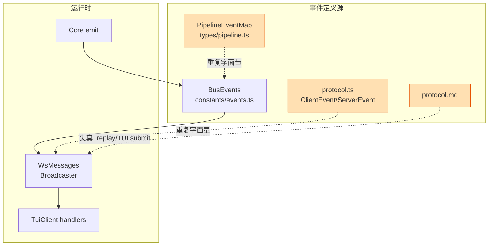

**目标（S6）**：

```text
EVENTS (single source)
  ├─ BusEvents (derived)
  ├─ WsMessages (derived)
  ├─ PipelineEventMap (derived)
  ├─ ServerEvent / ClientEvent (derived)
  └─ TuiClient message router (typed)
```

**已发现的契约 bug**：
- `conversation.chain` / `conversation.idle` 实际发送 `{ name, payload }`，类型声明是扁平 payload，只能 `as any`。
- WS `task.submit` 忽略 `payload.pipeline`（CR-COR-10）。
- `protocol.md` 的 `replay.event` 在代码中不存在（CR-DOC-08）。

---

## 6. Provider 流程：当前 vs 目标

### 当前

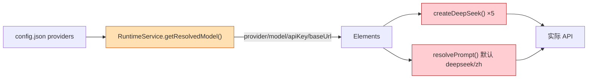

**问题**：
- `provider` 字段无人消费。
- 5 处独立 `createDeepSeek`。
- `resolvePrompt` 多数调用不传 provider/model。
- `providerOptions` 只有 deepseek 形状。

### 目标

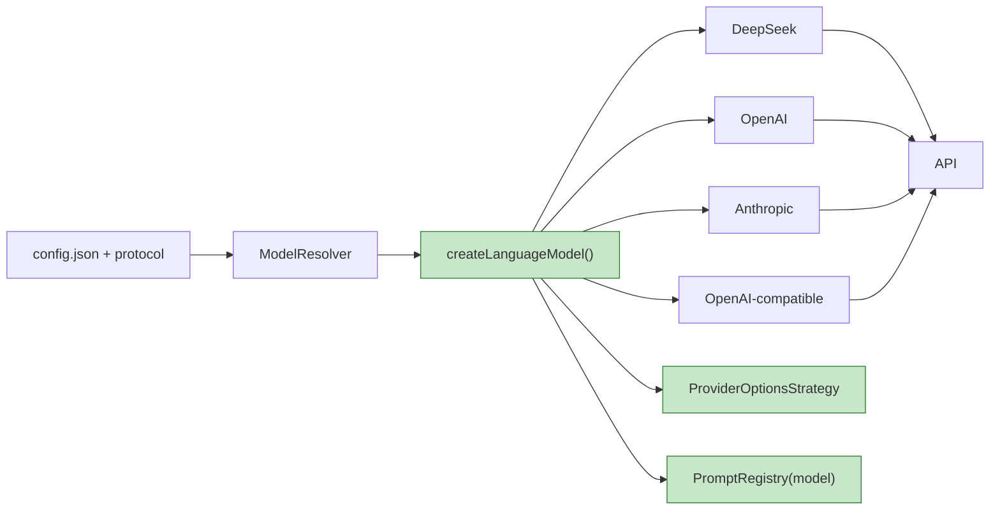

**验收节点**：
- 所有 Element 只接收 `LanguageModel` 或 `ResolvedModel`，不再 import provider SDK。
- `agents-compiler` 与主对话共用工厂。
- 四种 provider 的 fake 测试 + 可选 live smoke。

---

## 7. Node / Bun 运行时策略

> S9 的完整关系图与阶段依赖见 [code-review-s9-graph-2026-11-11.md](./code-review-s9-graph-2026-11-11.md)；本节保留全局运行时策略摘要。

### 当前

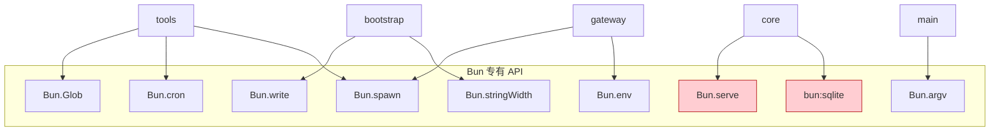

### 目标

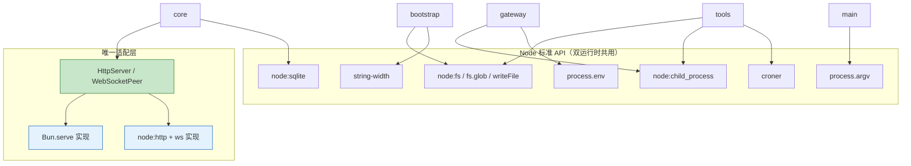

**决策门（S0）**：
- 若 `node:http + ws` 在 Bun 下可用 → 直接统一，删除 `Bun.serve`。
- 否则保留 `HttpServer` 双实现；这是唯一需要适配层的运行时能力。
- `node:sqlite` 本机已验证 Node 26 + Bun 1.4.2 + FTS5 均可用；最低版本在 S0 固化。

---

## 8. 重构阶段依赖图

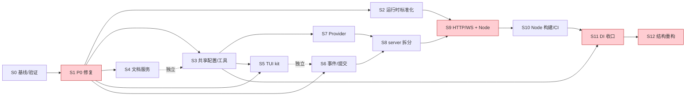

**关键约束**：
- S6 先于 S8：事件契约稳定后再拆 server。
- S7 先于 S12：Provider 改动会触碰 `stream-llm`，先完成再做拆分。
- S9 先于 S10：Node 入口/HTTP 稳定后再做构建与 CI。
- S11 先于 S12：先收口构造与全局状态，再拆文件。

---

## 9. 问题 ID ↔ 文件 ↔ 阶段

| CR ID | 主要文件 | 阶段 |
|---|---|---|
| CR-COR-01 | `config-tui/wizard-logic.ts` | S1 |
| CR-COR-02 | `core/server.ts` | S1 |
| CR-COR-03 | `services/memory-service.ts` | S1 |
| CR-COR-04 | `services/service-manager.ts`, `base-service.ts` | S1 |
| CR-COR-05 | `shared/log/sinks/pipe.ts` | S1 |
| CR-COR-06 | `core/server.ts` | S1 |
| CR-COR-07 | `pipelines/shared/index.ts` | S1 |
| CR-COR-08 | `post-conversation/finalize.ts` | S1 |
| CR-COR-09 | `task-queue.ts`, `tool-record-store.ts` | S1 |
| CR-COR-10 | `ws/handler.ts`, `api/tasks.ts` | S1/S6 |
| CR-COR-11 | `main.ts`, `bootstrap/cli.ts` | S1 |
| CR-DUP-01 | `tui/modal`, `config-tui/modal` | S5 |
| CR-DUP-02 | `theme.ts`, `theme.tsx`, `types.ts` | S5 |
| CR-DUP-03 | `bootstrap/config.ts`, `wizard-logic.ts`, `gateway/config.ts` | S3 |
| CR-DUP-04 | `bootstrap/env.ts`, `backup.ts`, `wizard-logic.ts` | S3 |
| CR-DUP-05 | `backup.ts`, `runtime-file.ts`, `menu-history.ts`, `persistence-service.ts` | S3 |
| CR-DUP-06 | helpers 多处 | S3 |
| CR-DUP-07 | `shared/types`, `services`, `core/skills` | S3 |
| CR-DUP-08 | `constants/events.ts`, `types/pipeline.ts`, `protocol.ts` | S6 |
| CR-DUP-09 | 旧 JSX 文档站 | S4 |
| CR-DUP-10 | 5 个测试文件 | S1/S3 |
| CR-DUP-11 | `stream-llm.ts`, `tool-loop.ts` | S12 |
| CR-DUP-12 | 消息投影多处 | S12 |
| CR-NAM-01..11 | 见审查文件 | S3/S12 |
| CR-DOC-01..10 | `docs/` | S4 |
| CR-ARCH-01 | `pipeline/registry.ts` | S11 |
| CR-ARCH-02 | `api/tasks.ts`, `task-engine.ts` | S11 |
| CR-ARCH-03 | `shared/prompts/index.ts` | S11 |
| CR-ARCH-04 | `gateway/server.ts` | S1/S11 |
| CR-ARCH-05 | `tui/components/App.tsx` | S5 |
| CR-ARCH-06 | `service-manager.ts`, `server.ts` | S11 |
| CR-ARCH-07 | Elements 多处 | S12 |
| CR-ARCH-08 | `task-engine.ts` | S11 |
| CR-ARCH-09 | `gateway/client-manager` | S12 |
| CR-ARCH-10 | `tui/components/App.tsx` | S5/S12 |
| CR-ARCH-11 | `config-tui/WizardApp.tsx` | S12 |
| CR-ARCH-12 | `stream-llm.ts` | S12 |
| CR-ARCH-13 | `server.ts` | S8 |
| CR-ARCH-14 | 死代码清单 | S4/S11（只修文档/不删 Element） |
| CR-ARCH-15 | `ws/handler.ts` | S6 |
| CR-RUN-01..07 | 运行时文件 | S2/S9/S10 |
| CR-PRO-01..06 | Provider 文件 | S7 |
| CR-STR-01..11 | 结构拆分 | S12 |

---

## 10. 禁区子图

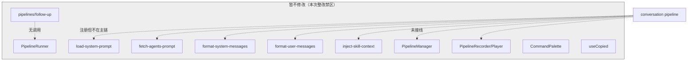

**说明**：
- 这些代码可以继续存在于仓库，但本次不重构、不删除、不接线。
- 文档中“已实现/可用”的错误声明要改；代码本身不动。
- 全局 registry 改造时，仍需保证这些 Element 的注册调用可编译/可运行。

---

## 11. 风险热力表

| 区域 | 变更风险 | 影响面 | 主要原因 |
|---|---|---|---|
| `stream-llm.ts` | 极高 | 全部对话 | 699 行 doProcess、工具治理、流式状态 |
| `server.ts` | 极高 | 启动/HTTP/WS/任务 | 组合根 + 路由 + 生命周期混合 |
| HTTP/WS 运行时 | 极高 | Core/Gateway/TUI | Bun.serve 与 Node http/ws 差异 |
| DI/全局状态 | 高 | 所有 pipeline 构造 | registry/pipelineMap/prompt singleton |
| MemoryService | 高 | 记忆/持久化 | DB 生命周期 + SQLite 迁移 |
| Provider 抽象 | 高 | 所有 LLM 调用 | 5 处 SDK + Prompt 语言 + options |
| TUI 状态 | 高 | 全部界面 | 全局 store、useChat 大 hook |
| 文档替换 | 中 | 文档 | 独立，但删除 6.5k 行 |
| 共享配置/工具 | 中 | bootstrap/config-tui/gateway | schema/env/atomic 多处调用 |
| P0 局部修复 | 低 | 单文件 | 可独立测试/回滚 |
