# Atom Neo Code Review Graph — S11 Global State / DI — 2026-11-12

> **Baseline**: `code-review/2026-11-10` @ `ef7ff15` (v1.22.12)
> **Scope**: S11 的当前全局状态、目标注入关系、关键序列、阶段依赖、风险与回滚
> **Related**:
> - [code-review-s11-2026-11-12.md](./code-review-s11-2026-11-12.md)
> - [code-review-s11-plan-2026-11-12.md](./code-review-s11-plan-2026-11-12.md)
> - [code-review-plan-2026-11-10.md](./code-review-plan-2026-11-10.md)

---

## 0. 图例

| 符号 | 含义 |
|---|---|
| 实线 | 直接依赖 / 调用 |
| 虚线 | 过渡包装、可选路径或待删除路径 |
| 红色节点 | 当前全局状态 / 高风险 |
| 橙色节点 | 需要改造或重点验证 |
| 绿色节点 | 目标实例化模块 |
| 蓝色节点 | 注入 / 组合根 |
| 灰色节点 | 禁区 / 范围外 |

---

## 1. S11 边界图

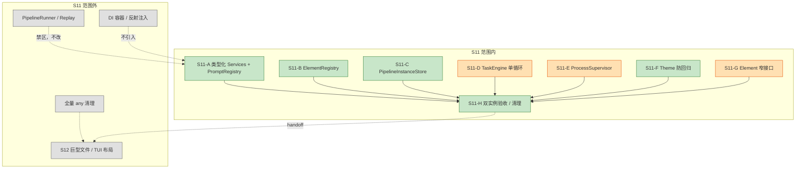

**结论**:

- S11 只改“谁创建、谁持有、谁注入”，不改 Element 算法、不改协议。
- 全量 `any` 与巨型文件拆分享 S12，不在 S11 做。
- CR-ARCH-04/05 已关闭，F 只是防回归。

---

## 2. 当前全局状态图

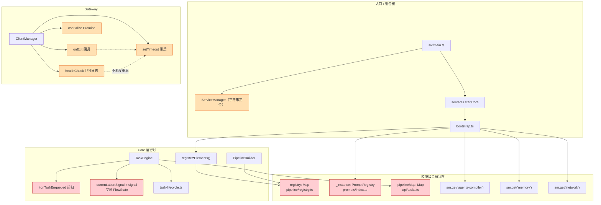

**观察**:

- 三张全局表（registry、prompt singleton、pipelineMap）互不相关，但都阻止双实例。
- `TaskEngine` 依赖 `api/tasks.ts`，形成 core 内部的分层倒置。
- `ClientManager` 的 exit/timer/health 没有共同状态源；健康检查是“只读告警”。
- 模块级全局不经过 logger/生命周期，测试无法隔离。

---

## 3. 目标 DI 图

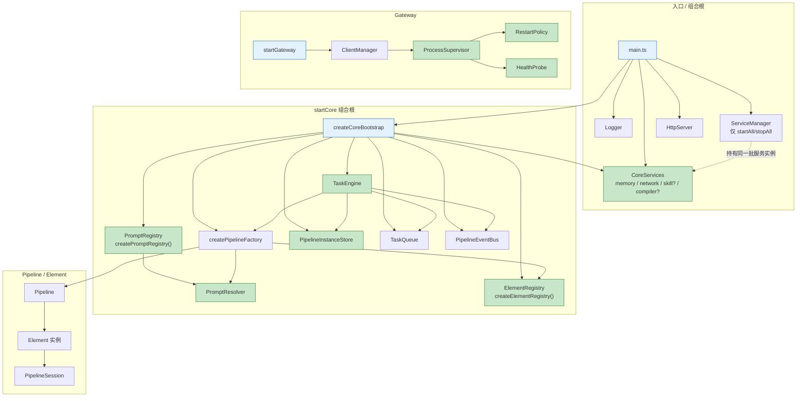

**关键边**:

- `main.ts` 是唯一同时知道具体服务类、logger、HttpServer、sandbox 的地方。
- `CoreServices` 是普通对象，不是容器；`ServiceManager` 不再进入 Core。
- `ElementRegistry` 与 `PromptRegistry` 由 `createCoreBootstrap` 创建，并沿 `createPipelineFactory → pipeline → Element` 注入。
- `PipelineInstanceStore` 只被 `TaskEngine` 读写；HTTP 层不再持有 pipeline。
- `ProcessSupervisor` 是 Gateway 内部唯一状态源；`ClientManager` 只做 facade。

---

## 4. ElementRegistry / Pipeline 构造序列

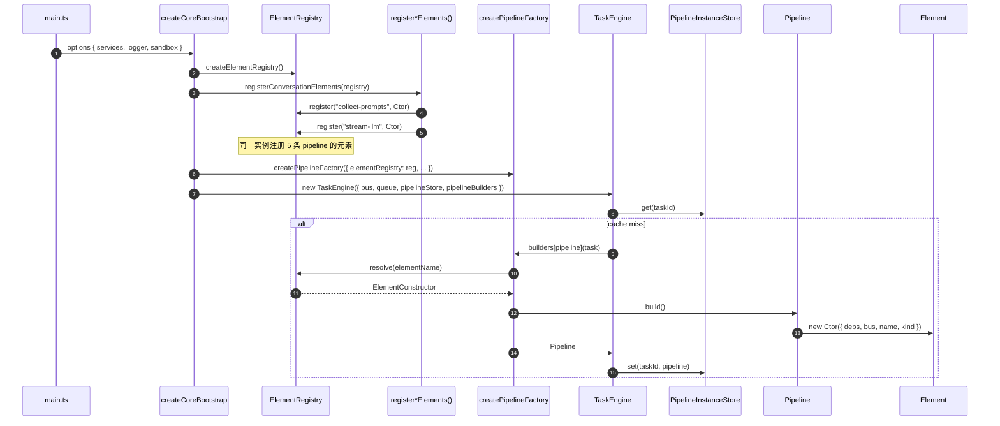

**不变式**:

- 注册顺序仍是 conversation → prediction → follow-up → follow-up-evaluator → context-compress → post-conversation → shared。
- Element 的构造参数（deps、bus、name、kind）不变；只多一个 registry 解析来源。
- 重复注册仍抛错；错误文案不变。

---

## 5. Prompt 解析序列

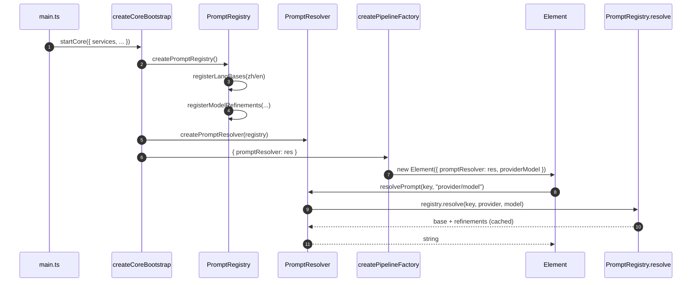

**不变式**:

- `LANGUAGE_MAP` 与 `MODEL_REFINEMENT_MAP` 不变。
- 缓存 key `key:provider:model` 与当前完全一致。
- 默认 provider/model 仍是 `openai/gpt-4o`（当未传 `providerModel`）。
- 两个 registry 可注册不同 refinement，互不影响；生产路径只创建一个。

---

## 6. TaskEngine 单循环序列

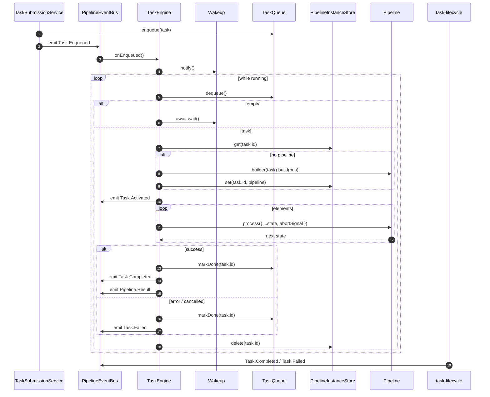

**关键点**:

- 唤醒只发生在 `Task.Enqueued`；事件处理器不执行任务。
- `dequeue` 先于 `wait`，避免“入队通知早于等待”丢失。
- `start()` 幂等；`stop()` 只置位并唤醒，不 abort 当前 task。
- `drain()` 仍轮询 `queue.size`，超时返回 false。
- FlowState 每次展开为新对象；Element 不修改上游对象。

---

## 7. PipelineInstanceStore 生命周期

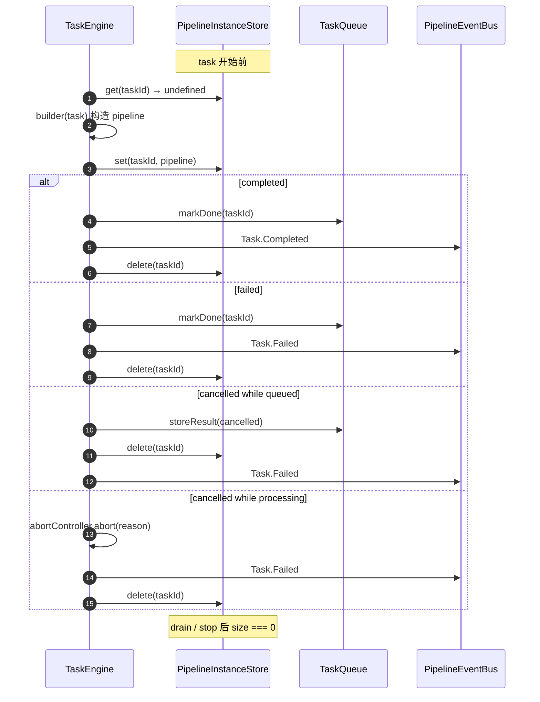

**不变式**:

- `store` 不持久化；进程重启后为空。
- 同一 taskId 的 pipeline 只构造一次；构造失败不写入。
- 取消 queued task 也要 `delete`（当前 `removePipeline` 行为）。
- `store.size` 可用于关闭验收；不做 TTL。

---

## 8. ClientManager / ProcessSupervisor 状态机

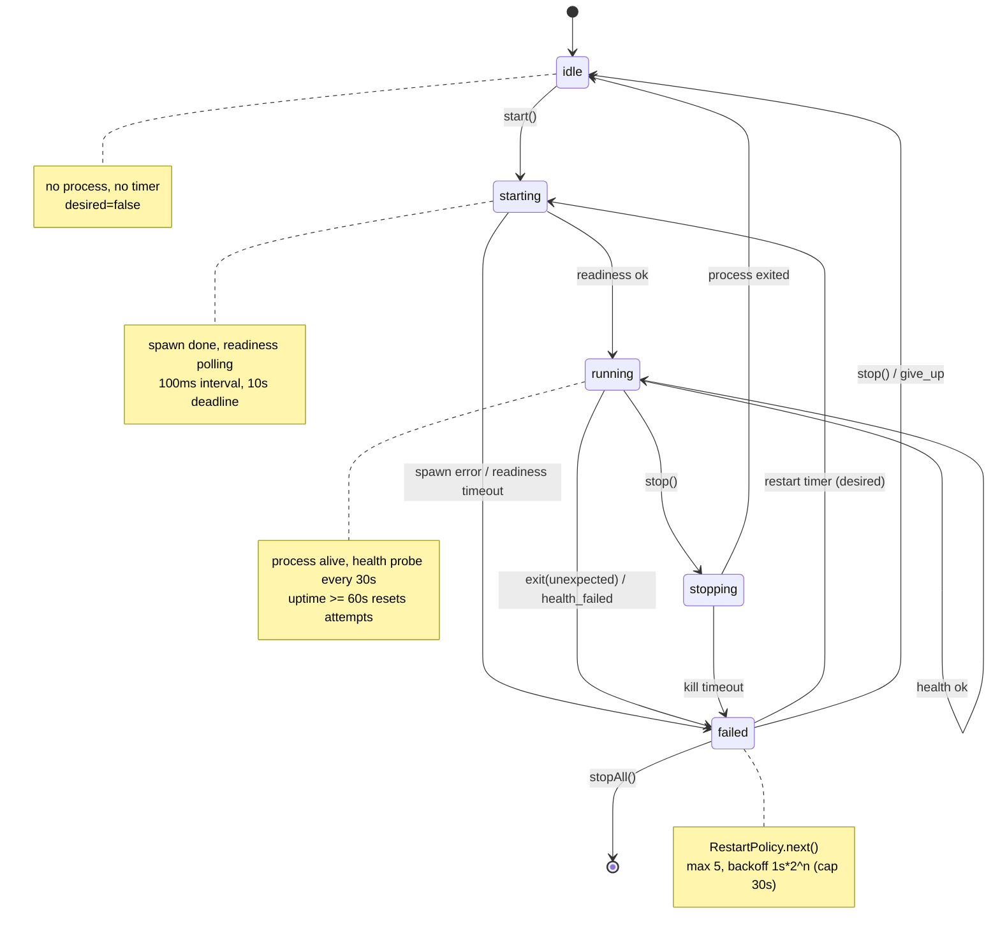

**并发约束**:

- 同一 client 的所有 `start/stop/restart/spawn/stopProcess` 通过一个操作队列串行。
- `stopAll` 先置 `stopping`、清 desired、清 timer，再并行 stop 所有 client。
- `exit` 回调只通知 supervisor；是否重启由状态机 + desired 决定，不在回调里直接 setTimeout。
- 健康失败与 exit 走同一 `failed` 入口；健康成功在 uptime ≥ 60s 时重置 attempts。
- `stop()` 后不得再因旧 timer 或旧 exit 回调进入 `starting`。

---

## 9. S11 子阶段依赖 DAG

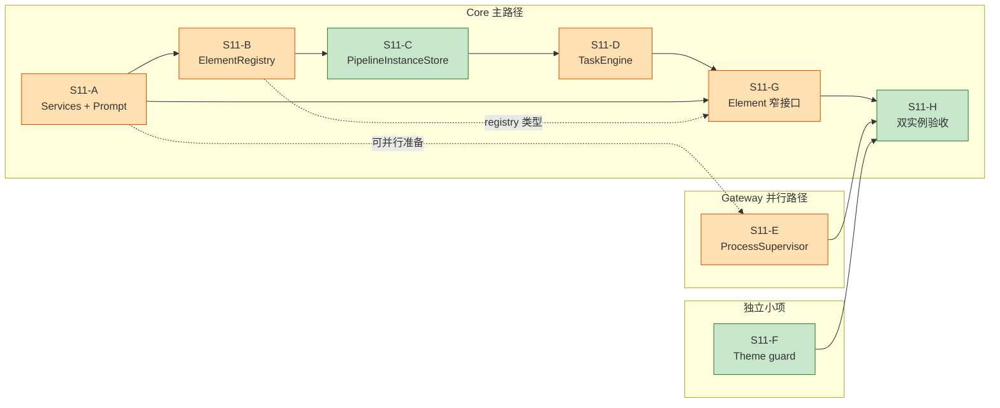

### 可并行

| 轨道 | 内容 | 前置 |
|---|---|---|
| Core-A | S11-A（Services + Prompt） | 无（但会改 bootstrap/pipeline-factory） |
| Core-B | S11-B（Registry） | A5 之后（同改 bootstrap） |
| Gateway | S11-E（ProcessSupervisor） | 无（独立包） |
| Theme | S11-F | 无 |
| 验收 | S11-H1/H2/H4/H5 | 对应实现完成 |

### 关键路径

```text
A5 → B7 → C2 → D2 → D6 → G2..G6 → H1 → H6 → H7
```

单开发者关键路径约 **89 小时**（不含 Gateway E 的 20 小时；E 可并行）。加上 15% 缓冲约 **102 小时 ≈ 13 个工程师日**。

### 不建议的并行

- `B6` 与 `A3` 同时改 `bootstrap.ts` / `pipeline-factory.ts` → 冲突。
- `D2` 与 `D3` 同时改 `task-engine.ts` → 冲突。
- `G2..G5` 同时改 `Element` 构造参数 → 冲突；按 pipeline 串行。
- `E5/E6` 同时改 `client-manager/index.ts` → 冲突；先抽文件再改 facade。

---

## 10. 风险热区

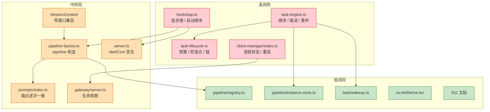

| 热区 | 风险 | 原因 | 首要验证 |
|---|---|---|---|
| `task-engine.ts` | 极高 | 单循环改变调度与取消路径 | 顺序/取消/事件顺序测试 |
| `task-lifecycle.ts` | 极高 | 预算回滚、检查点、链调度 | 现有 `task-lifecycle.test.ts` + 双实例 |
| `client-manager/index.ts` | 极高 | 三种并发机制、无现有测试 | fake spawn/probe/timer |
| `bootstrap.ts` | 高 | 所有对象构造顺序 | 两个 startCore |
| `pipeline-factory.ts` | 高 | 5 条 pipeline 的 deps 透传 | pipeline 快照/单测 |
| `prompts/index.ts` | 高 | 输出逐字一致 | prompt 快照 |
| `SessionContext → PipelineSession` | 中 | 结构赋值遗漏 | typecheck + pipeline 测试 |
| `server.ts` | 中 | startCore 签名 | 现有 server 测试 |
| `gateway/server.ts` | 中 | start/stop 顺序 | gateway 测试 |

---

## 11. 回滚关系

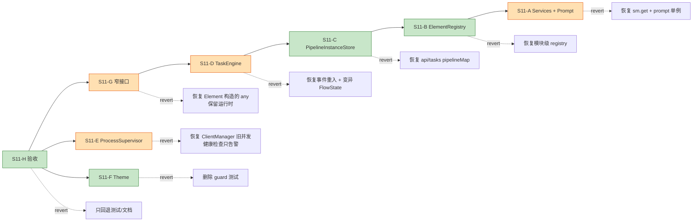

**回滚原则**:

- 每个任务一个 commit；回滚从后往前，不依赖后续任务。
- A/B/C 的过渡包装是“行为回滚点”：保留旧导出时，出问题可切回旧调用点。
- D 的回滚必须同时还原 `TaskEngine` 与 `PipelineInstanceStore` 注入（C2 之后）。
- E 的回滚保留 `ClientManager` 签名，只恢复内部旧并发实现。
- G 是类型层；回滚不影响运行时，但需恢复对应 `as any` 才可通过 typecheck。
- H 只回退测试/文档，不影响生产路径。

---

## 12. 测试覆盖图

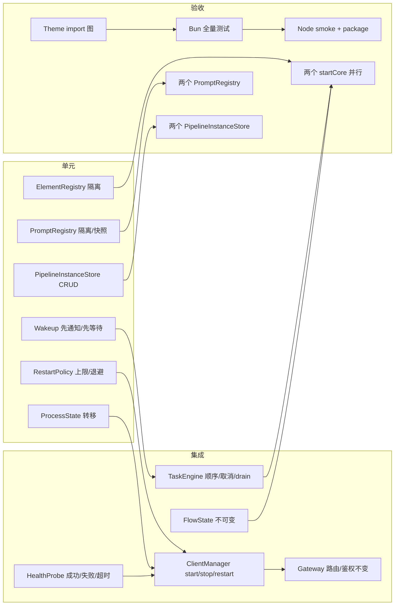

**门禁**:

- 每个任务至少新增/更新一个目标测试；纯类型任务用 `typecheck` + 现有测试。
- D/E 的测试必须先于重构提交（失败测试 → 实现 → 通过）。
- H1 双实例是 S11 的出口条件，不是 S12 的补充。
- Node smoke 只验证构建/启动/package，不要求跑全部 `bun:test`。

---

## 13. 禁止的依赖边

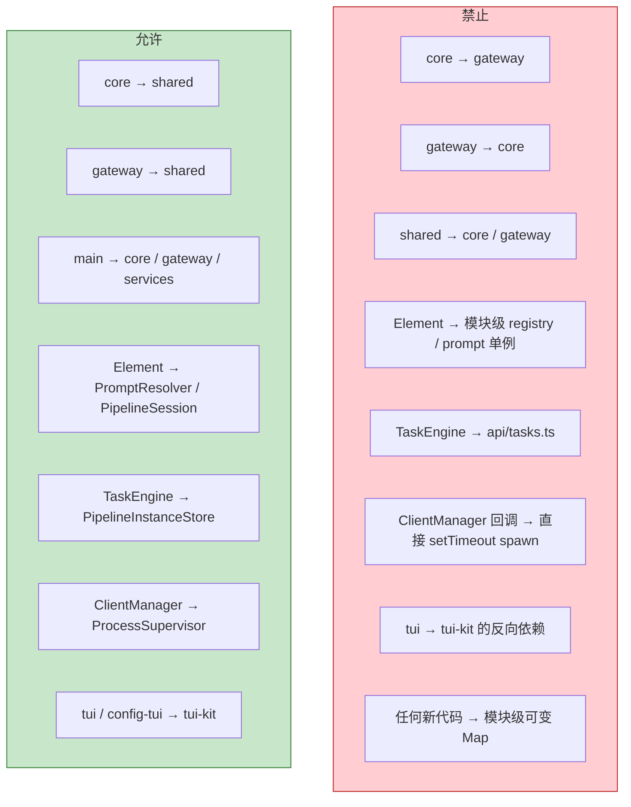

**说明**:

- `core` 与 `gateway` 不能互相依赖；共享契约只下沉到 `shared` 或 core 的窄类型文件。
- Element 不能 import 具体 registry 实例或单例；只能接收窄接口/函数。
- TaskEngine 不能 import `api/tasks.ts`；HTTP 层与执行层分离。
- ClientManager 的 exit 回调不能直接重新 spawn；必须经过 supervisor 状态机。
- TUI 主题只能单向依赖 `tui-kit`。
- S11 后新增模块级可变状态视为失败（DoD 检查）。
