# Atom Neo Code Review Graph — S12 Giant Files / TUI Structure — 2026-11-12

> **Baseline**: `code-review/2026-11-10` @ `e3b51f5` (v1.23.0, S11 complete)
> **Status**: **S12 已拆分，待实施**。本图描述当前巨型文件依赖、目标模块边界、关键序列、阶段依赖、风险与回滚。
> **Scope**: S12 的 Core 结构拆分与 TUI 结构拆分
> **Related**:
> - [code-review-s12-2026-11-12.md](./code-review-s12-2026-11-12.md)
> - [code-review-s12-plan-2026-11-12.md](./code-review-s12-plan-2026-11-12.md)
> - [code-review-plan-2026-11-10.md](./code-review-plan-2026-11-10.md)

---

## 0. 图例

| 符号 | 含义 |
|---|---|
| 实线 | 直接依赖 / 调用 |
| 虚线 | 过渡包装、可选路径或待删除路径 |
| 红色节点 | 当前巨型文件 / 高回归面 |
| 橙色节点 | 需要拆分或重点验证 |
| 绿色节点 | 目标模块 / 已关闭项 |
| 蓝色节点 | 组合根 / 对外 facade |
| 灰色节点 | 范围外 / 禁区 |

---

## 1. S12 边界图

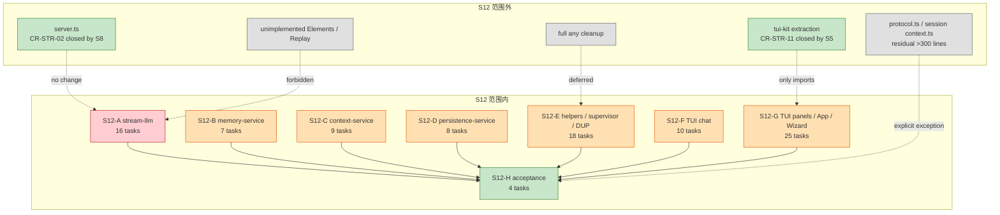

**结论**：

- S12 只做结构，不做功能；`server.ts` 与 `tui-kit` 只作为稳定依赖。
- 两个 TUI 阶段（F/G）与 Core 阶段（A-E）完全可并行，只有 H 需要全部完成。
- `protocol.ts` 与 `session/context.ts` 保持 >300 行是**显式例外**，不伪装成全仓库达标。

---

## 2. 当前巨型文件依赖图（Core）

```mermaid
graph TB
    subgraph Stream["stream-llm.ts (1240)"]
        SLLM["StreamLLMElement.doProcess"]
        SLOOP["while modelStep"]
        SSTEP["streamText + chunk"]
        STOOL["builtin/MCP tool wrappers"]
        SGOV["ToolCallLedger"]
        SCTX["Context snapshot / injection"]
        SREP["BusEvents + Transport"]
        SREC["ToolRecordStore"]
        SMAP["#toolResults side channel"]
        SFINAL["final result projection"]
    end

    subgraph Deps["依赖"]
        TL["tool-loop.ts"]
        GOV["tools/governance.ts"]
        CS["ContextService"]
        TRS["ToolRecordStore"]
        MP["model-provider.ts"]
        INTENT["builtin/intent.ts"]
        CONST["constants.ts"]
        CMP["context/compiler.ts"]
    end

    SLLM --> SLOOP
    SLOOP --> SSTEP
    SLOOP --> STOOL
    STOOL --> SGOV
    STOOL --> SMAP
    SLLM --> SCTX
    SLLM --> SREP
    STOOL --> SREC
    SLLM --> SFINAL
    SLLM --> TL
    STOOL --> GOV
    SCTX --> CS
    SCTX --> CMP
    SREC --> TRS
    SLLM --> MP
    SLLM --> INTENT
    SLLM --> CONST

    subgraph Memory["memory-service.ts (565)"]
        MS["MemoryService"]
        MDB["#initDb DDL/FTS"]
        MQ["search + ranking"]
        MG["traverse/link/edges"]
        ML["legacy migration"]
    end
    SQLITE["SqliteDatabase"]
    RANK["memory-ranking.ts"]
    MS --> MDB
    MS --> MQ
    MS --> MG
    MS --> ML
    MDB --> SQLITE
    MQ --> RANK
    MG --> RANK

    subgraph Context["context-service.ts (552)"]
        CSVC["ContextService"]
        CB["#buckets"]
        CSNAP["#snapshots + leases"]
        CLIFE["expire/sweep/dispose"]
        CPERS["export/restoreSessionState"]
    end
    COMP["compiler.ts"]
    CSVC --> CB
    CSVC --> CSNAP
    CSVC --> CLIFE
    CSVC --> CPERS
    CSVC --> COMP

    subgraph Persist["persistence-service.ts (515)"]
        PS["SessionPersistenceService"]
        PCK["generation write/publish"]
        PH["archive/search/read history"]
        PIO["durable/atomic IO"]
        PFMT["JSONL manifest"]
    end
    PTRS["ToolRecordStore"]
    PCS["ContextService"]
    PS --> PCK
    PS --> PH
    PS --> PIO
    PS --> PFMT
    PS --> PTRS
    PS --> PCS

    style SLLM fill:#ffcdd2,stroke:#b71c1c
    style SLOOP fill:#ffcdd2,stroke:#b71c1c
    style STOOL fill:#ffcdd2,stroke:#b71c1c
    style MS fill:#ffcdd2,stroke:#b71c1c
    style CSVC fill:#ffcdd2,stroke:#b71c1c
    style PS fill:#ffcdd2,stroke:#b71c1c
    style SMAP fill:#ffcdd2,stroke:#b71c1c
    style MDB fill:#ffe0b2,stroke:#e65100
    style CB fill:#ffe0b2,stroke:#e65100
    style CSNAP fill:#ffe0b2,stroke:#e65100
    style PCK fill:#ffe0b2,stroke:#e65100
```

**观察**：

- 四个 Core 巨型文件都把“生命周期 + 查询/执行 + 格式/IO + 上报”混在一起；彼此依赖是单向的，适合独立拆分。
- `stream-llm` 的 `#toolResults` 是跨函数侧信道，是最难搬移的状态。
- `persistence` 对 `ContextService` 是单向依赖；拆 checkpoint/history 不改变依赖方向。

---

## 3. 目标 Core 模块图

```mermaid
graph TB
    subgraph StreamTarget["stream-llm 目标"]
        SHELL["stream-llm.ts<br/>Element shell"]
        LOOP["stream-loop.ts"]
        STEP["stream-step.ts"]
        CTX["stream-context.ts"]
        REP["stream-reporting.ts"]
        FIN["stream-finalize.ts"]
        MI["stream-model-input.ts"]
        BATCH["tool-batch.ts"]
        TRT["tool-runtime.ts"]
        TRM["tool-runtime-mcp.ts"]
        TGR["tool-governance-runtime.ts"]
        TRS["tool-result-status.ts"]
        TL["tool-loop.ts<br/>stringify + projection"]
    end

    SHELL --> LOOP
    SHELL --> CTX
    SHELL --> FIN
    LOOP --> STEP
    LOOP --> BATCH
    LOOP --> REP
    LOOP --> CTX
    LOOP --> TRT
    BATCH --> TRT
    BATCH --> TRM
    TRT --> TGR
    TRM --> TGR
    TRT --> TRS
    STEP --> MI
    FIN --> MI
    BATCH --> TL
    TRT --> TL

    subgraph MemoryTarget["memory-service 目标"]
        MSVC["memory-service.ts<br/>facade"]
        MSTORE["memory-store.ts"]
        MQUERY["memory-query.ts"]
        MGRAPH["memory-graph.ts"]
        MTYPES["memory-types.ts"]
    end
    MSVC --> MSTORE
    MSVC --> MQUERY
    MSVC --> MGRAPH
    MQUERY --> MSTORE
    MQUERY --> MTYPES
    MGRAPH --> MSTORE
    MGRAPH --> MTYPES
    MSTORE --> MTYPES

    subgraph ContextTarget["context-service 目标"]
        CSVC["context-service.ts<br/>facade"]
        CBUCKET["bucket-store.ts"]
        CSNAP["snapshot-manager.ts"]
        CCODEC["context-codec.ts"]
        CTYPES["context-types.ts"]
    end
    CSVC --> CBUCKET
    CSVC --> CSNAP
    CSVC --> CCODEC
    CBUCKET --> CTYPES
    CSNAP --> CBUCKET
    CSNAP --> CTYPES
    CCODEC --> CTYPES

    subgraph PersistTarget["persistence-service 目标"]
        PSVC["persistence-service.ts<br/>facade"]
        PCK["checkpoint-store.ts"]
        PHIST["history-store.ts"]
        PFMT["session-format.ts"]
        PIO["durable-fs.ts"]
    end
    PSVC --> PCK
    PSVC --> PHIST
    PCK --> PFMT
    PCK --> PIO
    PHIST --> PFMT
    PHIST --> PIO

    subgraph HelperTarget["helpers 目标"]
        CFU["check-follow-up.ts"]
        CRULE["continuation-rules.ts"]
        CARB["continuation-arbitration.ts"]
        CMPF["compress-finalize.ts"]
        CMPC["compress-commit.ts"]
        CMPR["compress-resume.ts"]
        MPROJ["message-projection.ts"]
    end
    CFU --> CRULE
    CFU --> CARB
    CMPF --> CMPC
    CMPF --> CMPR
    CFU --> MPROJ
    CMPF --> MPROJ

    style SHELL fill:#c8e6c9,stroke:#2e7d32
    style LOOP fill:#c8e6c9,stroke:#2e7d32
    style STEP fill:#c8e6c9,stroke:#2e7d32
    style TRT fill:#c8e6c9,stroke:#2e7d32
    style MSVC fill:#c8e6c9,stroke:#2e7d32
    style CSVC fill:#c8e6c9,stroke:#2e7d32
    style PSVC fill:#c8e6c9,stroke:#2e7d32
    style CFU fill:#c8e6c9,stroke:#2e7d32
    style CMPF fill:#c8e6c9,stroke:#2e7d32
    style MPROJ fill:#c8e6c9,stroke:#2e7d32
```

**关键边**：

- `stream-llm` 只依赖 loop/context/finalize，不直接依赖 `streamText` 或工具执行。
- `tool-runtime` 是内置/MCP 的统一入口；`tool-runtime-mcp` 只做 MCP adapter。
- `memory-service` 是唯一公开 facade；`memory-store` 是唯一知道 SQLite 的模块。
- `context-service` 是唯一公开 facade；`bucket-store` / `snapshot-manager` 不互相持有完整服务。
- `persistence-service` 是唯一公开 facade；`checkpoint-store` / `history-store` 不互相调用。

---

## 4. 目标 TUI 模块图

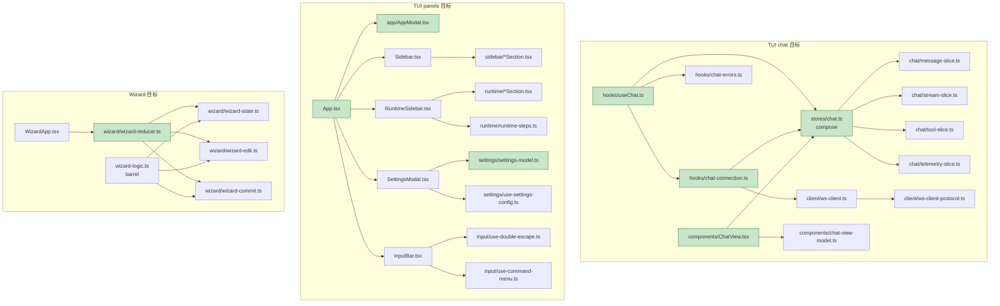

**边界**：

- store 的公开 API 不变；组件仍只 `useChatStore(selector)`。
- `chat-connection` 是唯一知道 `TuiClient` 事件名的地方；`useChat` 只做生命周期和 send/cancel。
- 面板 section 只读 store/theme；不再各自解析 ToolGroup。
- Wizard 的所有 view 跳转集中在 reducer；`WizardApp` 只 dispatch。

---

## 5. `stream-llm` 目标序列

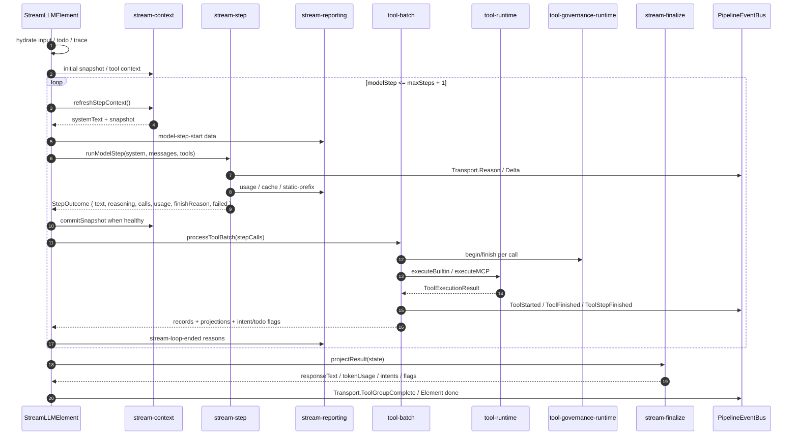

**顺序不变式**：

- `beforeCall` 在每次 `streamText` 前；timeout 在 `beforeCall` 期间暂停。
- usage 在 chunk 消费后、tool batch 前；snapshot commit 只在 `!streamFailed && !timedOut && !aborted`。
- tool batch 在 `model-step-ended` 之后；`ToolStepFinished` 在 batch 结束后。
- `stream-loop-ended` 在 seal tool group 之前，`done` 在最终结果投影前。

---

## 6. Memory 数据流

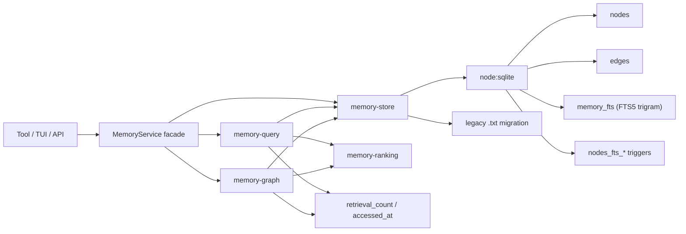

**不变量**：

- 表/索引/trigger 名称与 SQL 顺序不变。
- `search` 仍是 FTS5 长词 + `instr` 短词 + 过期过滤 + supersedes 过滤 + 0.4 覆盖率 + final score。
- `traverse` 仍是 BFS、最多 5 个结果、每层最多 3 个邻居、质量排序。
- `save` 的 content hash、UPSERT 冲突字段、supersedes edge 不变。

---

## 7. Context Snapshot 数据流

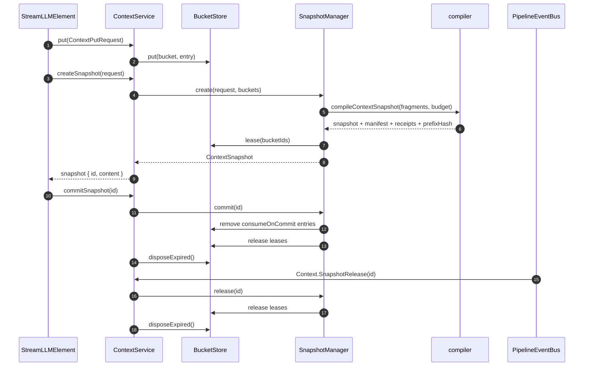

**不变量**：

- `createSnapshot` 仍先 `sweepExpired`，只选 active bucket，entry 过期过滤。
- lease 计数在 create 增加、commit/release 减少；`disposeExpired` 只删除 expired 且 lease=0 的 bucket。
- `commitSnapshot` 只删除 revision 匹配的 consumeOnCommit entry。
- snapshot TTL 默认 60 分钟；`sweepExpired` 负责 active→release、非 active→delete。

---

## 8. Persistence Checkpoint / Archive 流

**不变量**：

- generation 名 `g-<12位 revision>-<uuid>`；`current` 是目录软链；顶层 `session.json`/`context.json`/`message-latest.jsonl`/`tool-records.jsonl` 是兼容软链。
- 提交点是 `current` 的 rename；旧 generation 清理失败不影响已提交 checkpoint。
- archive segment 写入后不可修改；verify 失败删除并抛错。
- `restore` 只在原 status 为 active 时写 `restore` checkpoint。

---

## 9. TUI 事件 / 状态流

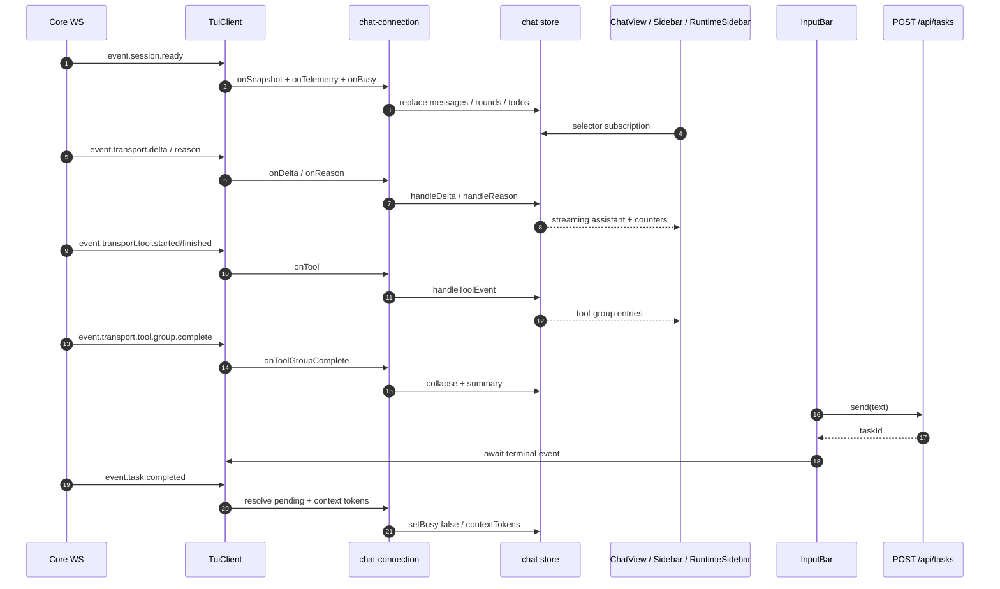

**不变量**：

- `session.ready` 先于任何任务事件；snapshot 替换后 `activeAssistantId` 为空。
- `onDisconnect` 清空 telemetry 并插入 error 消息；不会自动重连。
- busy 由 `activeTaskIds.size > 0` 推导；`Task.Completed` 的 terminal 只 resolve 对应 rootTaskId。
- 输入/发送失败：`TaskCancelledError` → transient info 2s；API key invalid → `onClientError`；其他 → error message。

---

## 10. S12 子阶段依赖 DAG

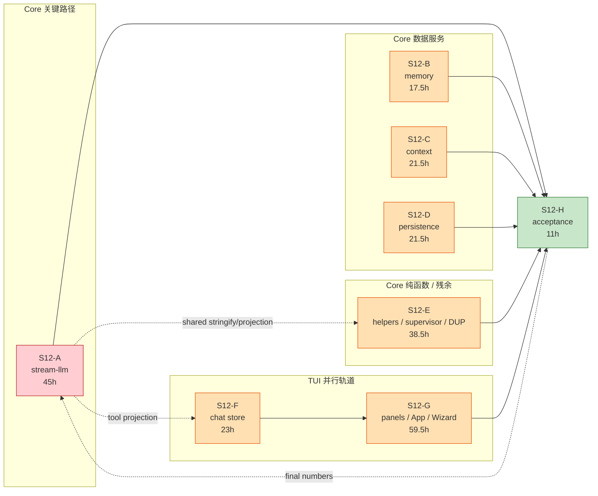

### 可并行

| 轨道 | 内容 | 前置 |
|---|---|---|
| Core-Stream | S12-A1..A16 | 无（最重要） |
| Core-Data | S12-B / C / D | 无（彼此不同目录） |
| Core-Helpers | S12-E | 无；E17 依赖 A3 |
| TUI-Chat | S12-F | 无 |
| TUI-Panels | S12-G | F 完成（G 使用 store 稳定 API；也可在 F1/F6 后开始） |
| Acceptance | S12-H | 全部 |

### 不建议的并行

- A9/A10/A14 同时改 `stream-llm.ts` 的 `doProcess` → 冲突；必须按 A2→A4..A15 顺序逐段切。
- C4/C5/C6 同时改 `context-service.ts` 的 bucket/snapshot 字段 → 冲突；先 store 后 manager。
- D4/D6 同时改 `persistence-service.ts` 的私有方法 → 冲突；先 checkpoint 后 history。
- G2/G3/G4 同时改 `Sidebar.tsx` → 冲突；先 section 再 composition。
- G19..G21 同时改 `wizard-logic.ts` → 冲突；按 state→edit→commit 顺序。

---

## 11. 关键路径与并行建议

**关键路径（Core-Stream）**：A1 → A2 → A4 → A5 → A6 → A7 → A8 → A13 → A14 → A15 → A16 → H2 → H4 ≈ **51h**。

**最长并行轨道（TUI）**：F1 → F6 → G1 → G5/G9/G12/G15/G17/G24 → H2 ≈ **82.5h（含 H2/H4 约 85h）**。

**建议配置**：

| 人数 | 分配 | 预计（含 15% 缓冲） |
|---:|---|---|
| 1 | 全部串行 | 237.5h → **约 30 工程师日 / 7 周** |
| 2 | Core 全部 / TUI 全部 | max(151h, 86.5h) ≈ 151h → **约 22 工程师日 / 4–4.5 周** |
| 3 | Core-Stream / Core-Data+Helpers / TUI | 99h → **约 15 工程师日 / 3 周** |
| 4 | Core-Stream / Core-Data / Core-Helpers / TUI | 82.5h → **约 12 工程师日 / 2.5 周** |

> 原计划“8–12 天”对应约 64–96h，只能覆盖 A+B+C 的主路径，无法覆盖 D/E/F/G/H。建议按 **3–4 人、12–15 个工作日**排期；单人需 6–7 周。

---

## 12. 风险热区

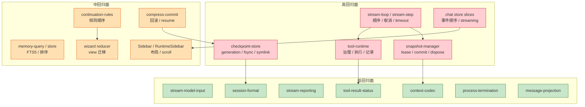

| 热区 | 原因 | 首要验证 |
|---|---|---|
| `stream-loop` / `stream-step` | 循环顺序、timeout、abort、usage | stream character + boundaries + cache |
| `tool-runtime` | 内置/MCP 治理与记录 | tool-loop + stream tests |
| `snapshot-manager` | lease/commit/dispose 时机 | context-service + stream-cache |
| `checkpoint-store` | fsync/rename/symlink 顺序 | persistence tests + 目录快照 |
| TUI chat store | delta/tool/busy 事件顺序 | chat store tests + App smoke |
| memory query/store | FTS5 与排序 | memory tests + schema dump |
| continuation rules | 规则优先级 | check-follow-up tests |
| compress commit | checkpoint 回滚/resume | compress tests |
| wizard reducer | view 顺序/quit guard | WizardApp tests |

---

## 13. 回滚关系

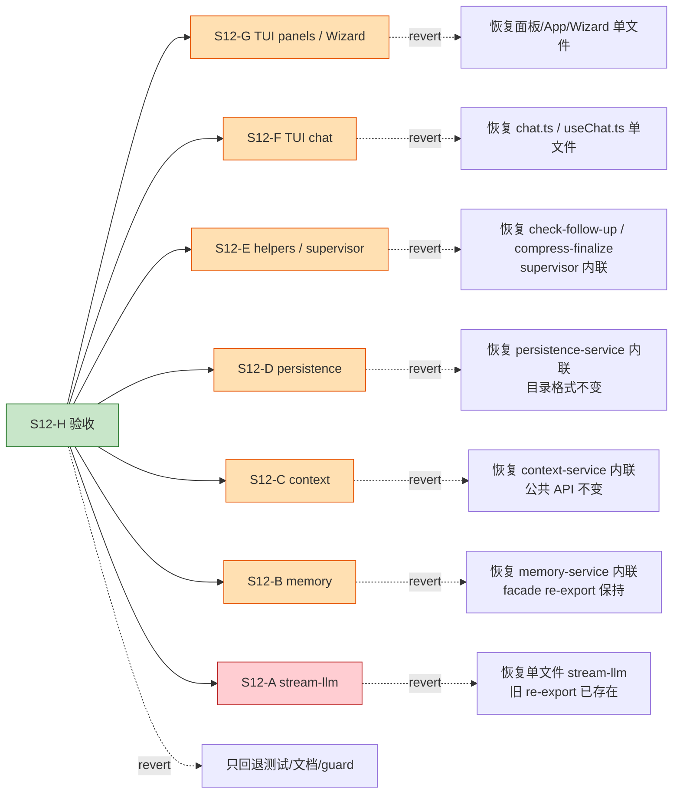

**回滚原则**：

- 每个任务一个 commit；回滚从后往前，不依赖后续任务。
- 所有“提取模块”任务先保留 facade re-export；删除旧路径单独一个 commit（A16/B7/C9/D8/E18/F10/G25）。
- 纯搬移任务回滚只恢复 import/调用点；新文件可保留（不参与编译）。
- `stream-llm` 回滚必须同时回退 A14/A15 的 loop/finalize 调用；A16 之后回滚需先恢复旧 re-export。
- B/C/D 回滚只影响内部结构；公共 API、DB/文件格式不变。
- F/G 回滚不影响 Core；TUI 组件测试与手工 smoke 是主要防线。
- H 只回退测试/文档/guard，不回退生产代码。

---

## 14. 测试覆盖图

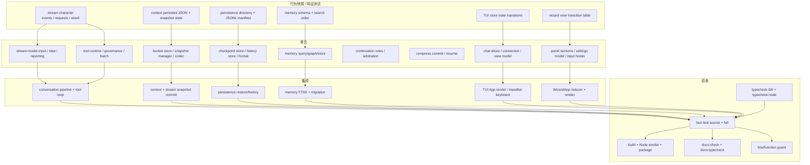

**门禁**：

- 每个结构任务至少更新一个目标测试；纯搬移任务用“旧测试不改也通过 + 新模块单测”。
- A1/B1/C1/D1/F1/G18 是阶段入口：没有行为快照不开始搬移。
- H1 的 guard 是出口条件：目标文件超 300 行或主函数超 100 行即失败。
- Node smoke 只验证构建/启动/package，不要求跑全部 `bun:test`。

---

## 15. 禁止的依赖边

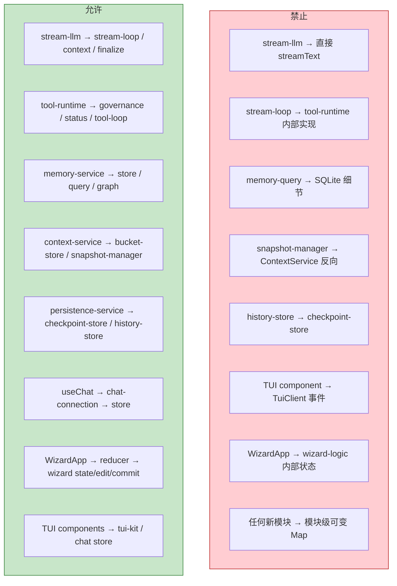

**说明**：

- `stream-llm` 是编排层，不再直接知道 AI SDK 的 `streamText`。
- `stream-loop` 只通过 `tool-batch`/`tool-runtime` 的公开函数执行工具，不读 `#toolResults`。
- `memory-query` 不写 SQL DDL；所有 schema 在 `memory-store`。
- `snapshot-manager` 不直接改 bucket entry；通过 `BucketStore` 窄方法。
- `history-store` 不解析 `current` 指针；checkpoint 生命周期只属于 `checkpoint-store`。
- TUI 组件不订阅 `TuiClient`；只有 `chat-connection` 接收事件。
- Wizard 组件不直接修改 wizard 字段；只 dispatch action。
- 新增模块级可变状态视为失败（S11 DoD 延续）。
