# Atom Neo Code Review Graph — S9 HTTP/WS Runtime — 2026-11-11

> **Baseline**: `code-review/2026-11-10` @ `fc78eac` (v1.22.9)
> **Scope**: S9 的运行时关系、双实现、阶段依赖与风险热区
> **Related**:
> - [code-review-s9-2026-11-11.md](./code-review-s9-2026-11-11.md)
> - [code-review-s9-plan-2026-11-11.md](./code-review-s9-plan-2026-11-11.md)
> - [code-review-graph-2026-11-10.md](./code-review-graph-2026-11-10.md)

---

## 0. 图例

| 符号 | 含义 |
|---|---|
| 实线 | 直接依赖 / 调用 |
| 虚线 | 可选实现、动态导入或待删除路径 |
| 红色节点 | 当前阻断点 / 高风险 |
| 橙色节点 | 需要改造或重点验证 |
| 绿色节点 | 目标统一模块 |
| 灰色节点 | 禁区 / 范围外 |
| 蓝色节点 | 适配层实现 |

---

## 1. S9 边界图

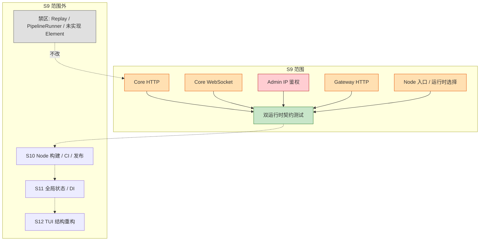

**结论**：

- S9 只解决“传输”和“入口”，不解决构建/发布。
- 双运行时测试是 S9 的出口条件，不是 S10 的补充。
- 禁区代码不进入 S9 依赖链。

---

## 2. 当前运行时关系

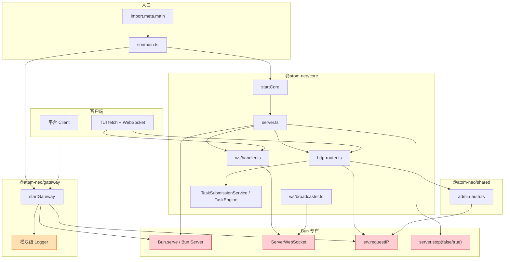

**观察**：

- `startCore` 与 `startGateway` 都直接拥有传输，Node 入口没有注入点。
- `admin-auth` 被 Core 与 Gateway 共用，但签名绑定 Bun server。
- `TaskSubmissionService` 已经与传输解耦；S9 不应再改动它。

---

## 3. 目标运行时关系

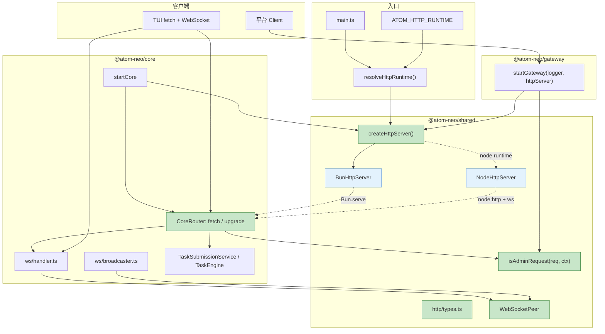

**关键边**：

- `main.ts → resolveHttpRuntime → createHttpServer`：唯一运行时选择点。
- `startCore/startGateway → HttpServer`：只依赖契约，不依赖 Bun/Node。
- `CoreRouter.fetch/upgrade`：HTTP 与升级分流，适配器各自实现。
- `WebSocketPeer`：handler/broadcaster 只看 peer，不看 Bun/Node。

---

## 4. HTTP 请求生命周期

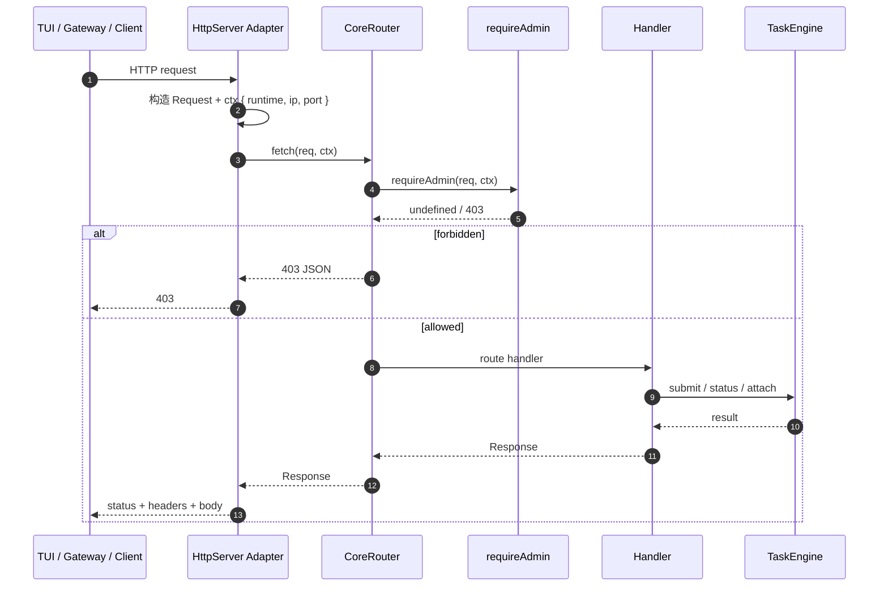

**Node 桥接点**：

- `IncomingMessage → Request`：method、URL、headers、body、abort signal。
- `Response → ServerResponse`：status、headers、`Set-Cookie`、204/304/HEAD、stream body。
- `ctx.ip` 来自 `socket.remoteAddress`，不读代理头。

---

## 5. WebSocket 升级生命周期

### 5.1 Bun 路径

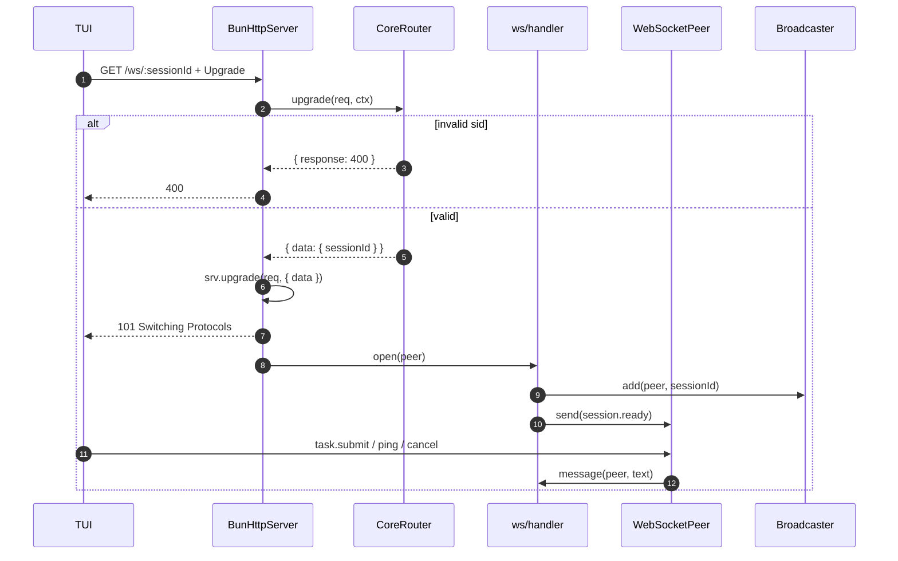

### 5.2 Node 路径

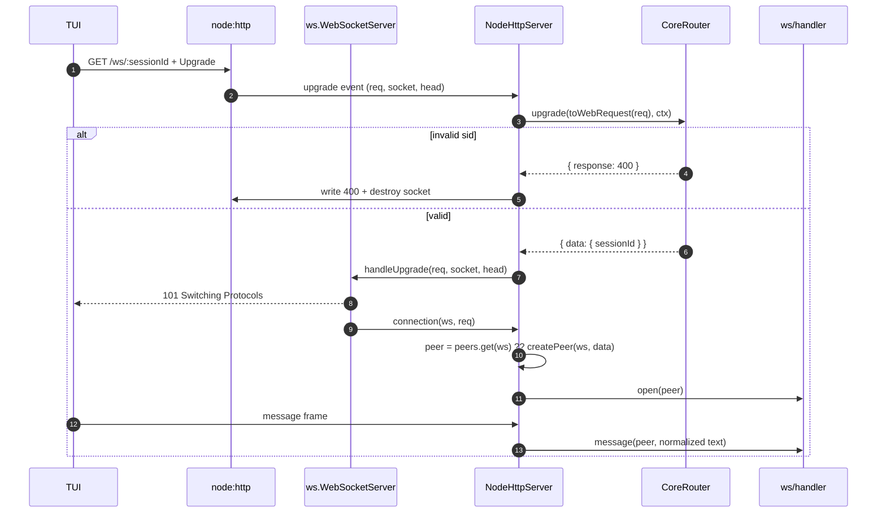

**关键不变式**：

- Node 的 `peer` 必须按 `ws.WebSocket` 缓存；`open` / `message` / `close` 使用同一对象。
- `close` 与 `error` 都要调用 `broadcaster.remove(peer)`，且只清理一次。
- Bun 的 `ServerWebSocket` 可直接作为 peer；不额外包一层，避免身份不一致。

---

## 6. 模块依赖目标

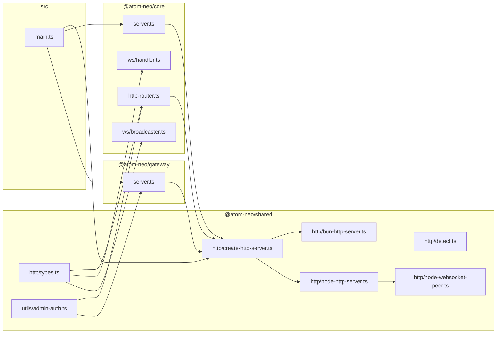

**依赖方向**：

- `shared` 不依赖 `core` / `gateway`。
- `core` / `gateway` 只依赖 `shared` 的契约与工厂。
- Node adapter 的 `ws` 依赖只在 `shared/src/http` 内动态加载。
- `tui` 不依赖 `shared/src/http` 的服务端实现。

---

## 7. S9 阶段依赖与决策门

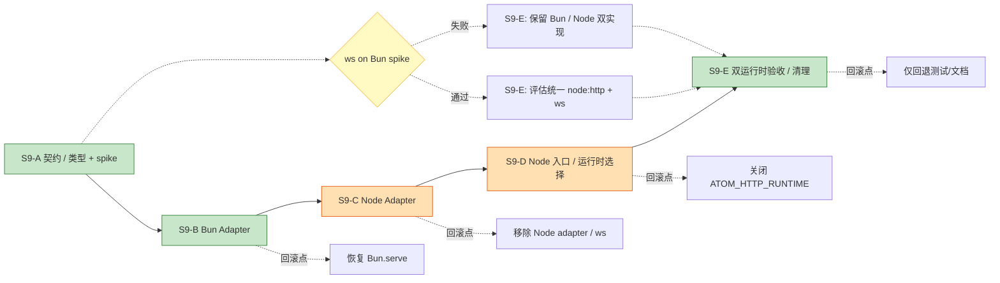

**顺序理由**：

- 先有契约，才能让 Bun 与 Node 共享 router/handler。
- 先有 Bun adapter，才能在“行为完全不变”的前提下验证契约。
- Node adapter 在 Bun 通过后再接，避免同时调试两套传输。
- 入口最后切换；即使入口有问题，adapter 仍可独立测试。

---

## 8. 文件与风险热区

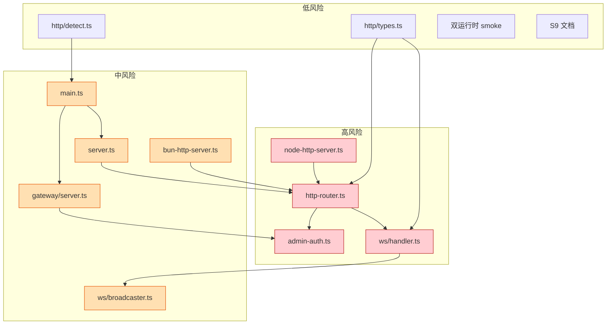

| 热区 | 风险 | 原因 | 首要验证 |
|---|---|---|---|
| `http-router.ts` | 极高 | upgrade 拆分 + 所有路由 | 路由表逐条回归 |
| `admin-auth.ts` | 极高 | 403 误判会锁死 TUI | loopback/远端/IPv4-mapped |
| `ws/handler.ts` | 极高 | 协议入口 + peer 生命周期 | session.ready / task.submit |
| `node-http-server.ts` | 极高 | Request/Response 桥接 | body/headers/204/304/stream |
| `server.ts` | 高 | 两阶段 stop | drain / force close |
| `gateway/server.ts` | 高 | 独立传输 + admin | 鉴权/限流/stop |
| `main.ts` | 中 | 运行时选择 | Bun 默认 / Node 可选 |
| `bun-http-server.ts` | 中 | 现有行为唯一出口 | 与 `fc78eac` 逐项对比 |
| `ws/broadcaster.ts` | 中 | peer key / 清理 | 多连接/断开/发送失败 |

---

## 9. 测试覆盖图

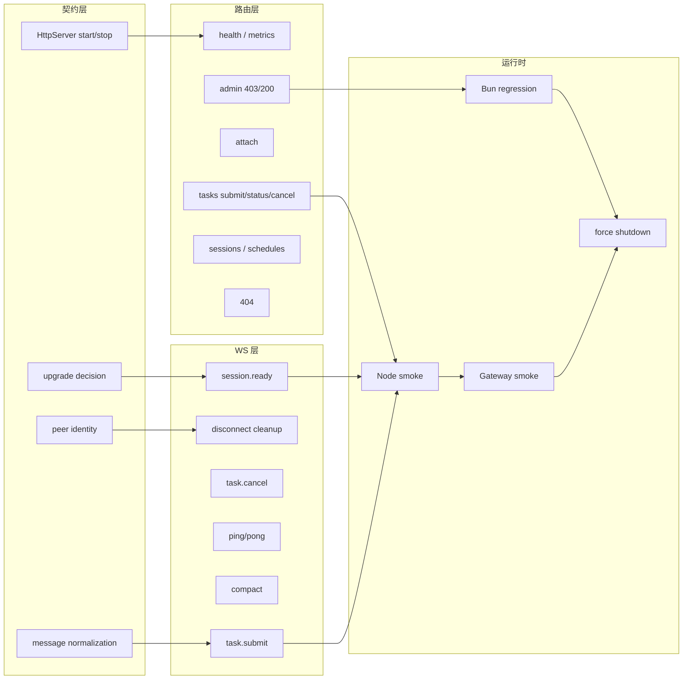

**门禁**：

- `bun:test` 继续覆盖契约、路由、WS、Core 启停。
- Node smoke 覆盖真实 `node:http` + `ws` 路径，不依赖 `bun:test`。
- 两边使用同一组场景和断言口径。

---

## 10. 回滚关系

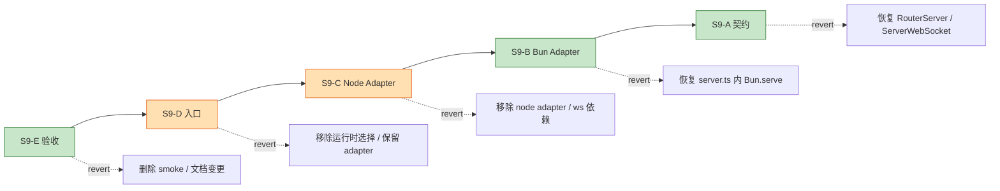

**原则**：

- 按子阶段 commit，回滚从后往前。
- S9-B 是行为回滚点：保留 Bun adapter 时，Node 出问题不影响 Bun。
- S9-C 是依赖回滚点：移除 `ws` 与 Node adapter 即恢复 Bun-only。
- S9-D 是入口回滚点：删除环境变量分支即可。
- S9-E 只回退测试/文档，不影响运行时。

---

## 11. 禁止的依赖边

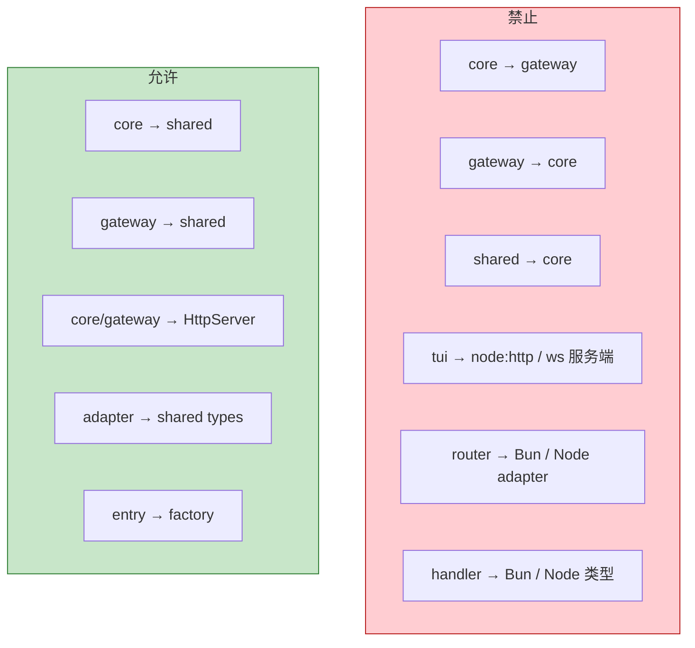

**说明**：

- `core` 与 `gateway` 不能互相依赖；共享代码只能下沉到 `shared`。
- 路由层不能 import 具体 adapter；否则 Node/Bun 分支会渗透到业务。
- 业务 handler 不能 import `bun` 或 `ws` 类型；只能使用 `WebSocketPeer`。
- TUI 是客户端，不加载服务端 `node:http` / `ws` 实现。
