# Atom Neo — Gateway Client 打包接入：关系图

> 项目：`atom_neo`
> 日期：2026-11-14
> 开发目标：`gateway_client_packaging`
> 状态：**G0 已确认；M1（G1）、M2（G2）、M2.1、M3a（G3）、M3b（G4）、M4/G5 已实施；G6 代码与文档完成，真实平台/官方发布待执行**
> 2026-11-15 修订：启动方式不再兼容旧 `binary`，启动路径只保留 `package` / `directory`。
> M1 落地 `manifest.ts`、`resolver.ts`、`config/client-instance.ts`、凭据过滤与 `ResolvedClientConfig` 启动链路；M2 落地 Telegram manifest、pack/install、`registry.ts`、离线实例配置与 config-tui 表单。动态 ClientManager、管理接口与 CLI/TUI 仍在后续阶段。
>
> 本文用文件与代码片段说明改造关系。
> 计划见 [plan](./atom_neo_2026-11-14_gateway_client_packaging_plan.md)，文件与示例代码见 [code_and_file](./atom_neo_2026-11-14_gateway_client_packaging_code_and_file.md)。

---

## 1. 阅读顺序

```text
plan.md            目标、阶段、验收、待确认决策
  └─> code_and_file.md   每个文件的职责与示例代码
        └─> graph.md     本文：模块边界、数据流、运行时序列
```

---

## 2. 系统上下文

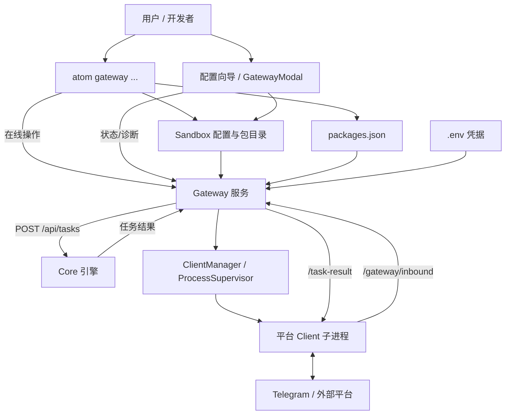

**边界**

- `atom gateway` 是短时命令，不启动 Core/Gateway 服务。
- Gateway 只读 `config.json` / `.env`；写入由 CLI/配置向导完成（G0 D4）。
- Client 只通过 Gateway 与 Core 交互，不直接连 Core。
- `packages.json` 与包目录都属于 sandbox。

---

## 3. 阶段依赖

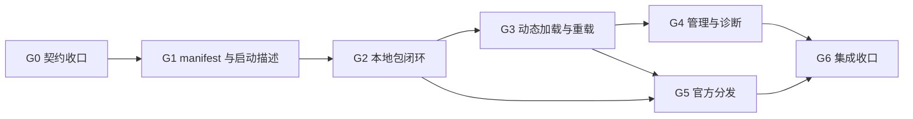

**并行边界**

- G4 可在 G2 后先做离线配置；在线状态依赖 G3。
- G5 的官方安装可在 G2 后开始；升级/切换依赖 G3。
- G6 的最后验收依赖 G1–G5。

---

## 4. 文件与模块依赖

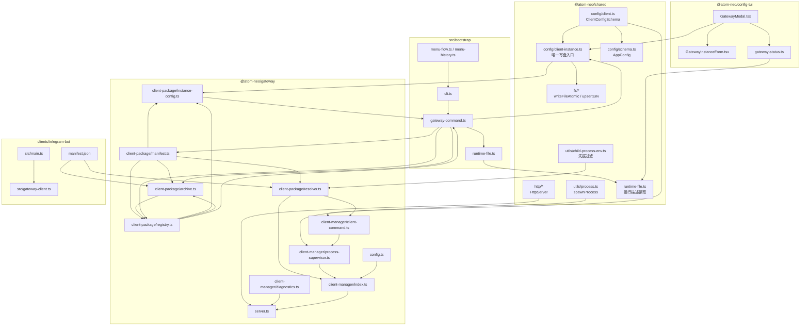

**依赖规则**

- `shared` 不导入 `gateway`、`config-tui`、`bootstrap` 或 `clients`。
- `gateway` 只导入 `shared`，不导入 `bootstrap`。
- `bootstrap` 可以导入 `gateway` 与 `shared`。
- `config-tui` 只导入 `shared` 与 `tui-kit`；运行状态通过 HTTP 读取，不导入 `gateway`。
- `clients/telegram-bot` 独立构建，不导入 Atom 工作区包。

---

## 5. 核心数据模型

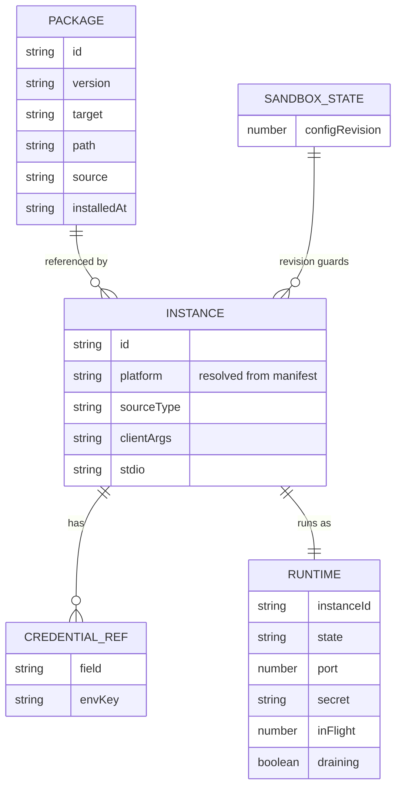

### 5.1 配置示例

```jsonc
// config.json
{
  "gateway": {
    "port": 3000,
    "clients": [
      {
        "id": "telegram-main",
        "package": { "id": "telegram-bot", "version": "0.1.0" },
        "clientArgs": { "mode": "longpoll" },
        "credentials": {
          "bot-token": "ATOM_CLIENT_TELEGRAM_MAIN_BOT_TOKEN"
        },
        "stdio": "inherit"
      }
    ]
  }
}
```

```dotenv
# .env
ATOM_CLIENT_TELEGRAM_MAIN_BOT_TOKEN=123456:ABC-DEF...
```

启动时映射：

```text
instances["telegram-main"].credentials["bot-token"]
  -> .env[ATOM_CLIENT_TELEGRAM_MAIN_BOT_TOKEN]
  -> child env TELEGRAM_BOT_TOKEN
```

---

## 6. 启动：包/目录统一路径

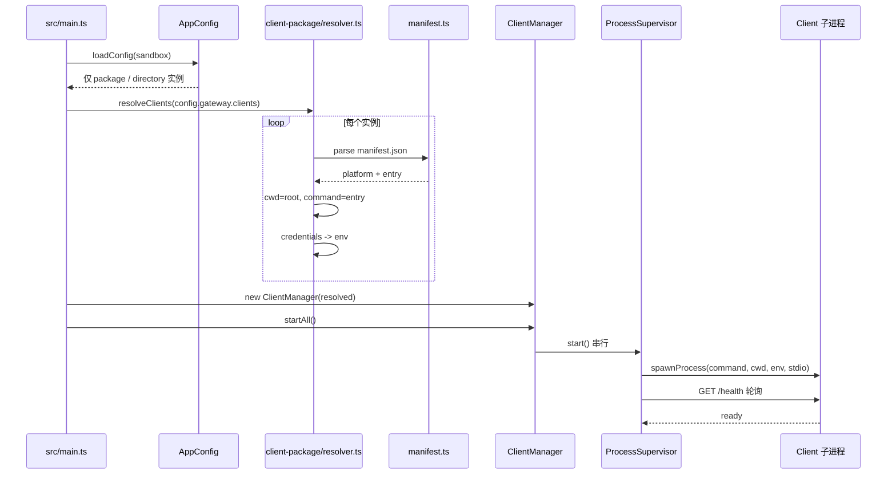

**M1 边界**

- `ClientManager` 仍按启动时的 `ResolvedClientConfig[]` 构造 supervisor；动态登记/移除/重载（`#configs`、活动端口集合）属 G3，尚未实现。
- `main.ts` 在启动 Gateway 前调用 resolver；Gateway 包自身不读取 sandbox 配置。
- `main.ts` 向 resolver 传入 `baseDir: sandbox`；`directory` 的相对路径以 sandbox 根目录为基准，绝对路径原样使用。
- 包安装目录由 registry 登记的记录提供；未登记包不再回退到手工目录。

**M2.1 硬化**

- `ClientManager` 向 supervisor 传 `gatewayPort: () => config.port`；`startGateway` 在 `serve()` 后更新 `config.port`，spawn/restart 时读取真实端口。
- registry 的 `registerPackage` / `removePackage` 用 `.atom/gateway/packages.lock` 串行化 read-modify-write；锁有界重试/超时，registry 文件仍原子写。

**M3a（G3）**

- `ClientManager` 动态 `register/remove/reload/status`；端口按活动集合分配；每实例队列；reload 用新 supervisor 替换旧对象。
- `server.ts` 提供 GET 状态/诊断、POST reload；目标实例 drain 期间 inbound 503，超时 409 保留旧进程；`resolveClient` 由 `main.ts` 注入。
- `DiagnosticsStore` 每实例 50 条；可选 Client `GET /diagnostics`，404 为 `unsupported`，不读取 `/health` 作为平台认证。Client checks 在 Gateway 侧限制 20 条、字段 200 字符、总 JSON 8 KiB，并脱敏未知字段之外的常见 Token/Secret/UUID 形态。
- Telegram `submitInbound`/`processUpdateBatch`：503/429 不推进 offset；`atom gateway` CLI 离线/在线分流不初始化 Core。

**不变量**

- 配置只接受 `package` / `directory`；`binary` 在配置校验阶段拒绝，不进入 resolver。
- 入口数组直接传 `spawnProcess`。
- Gateway 追加 `--secret`、`--port`、`--gateway-url`。
- `clientArgs` 只能追加普通参数，不能覆盖保留参数。
- 子进程环境只包含目标实例凭据，不含 `ATOM_ADMIN_TOKEN`。

---

## 7. 本地包闭环：pack → install → config

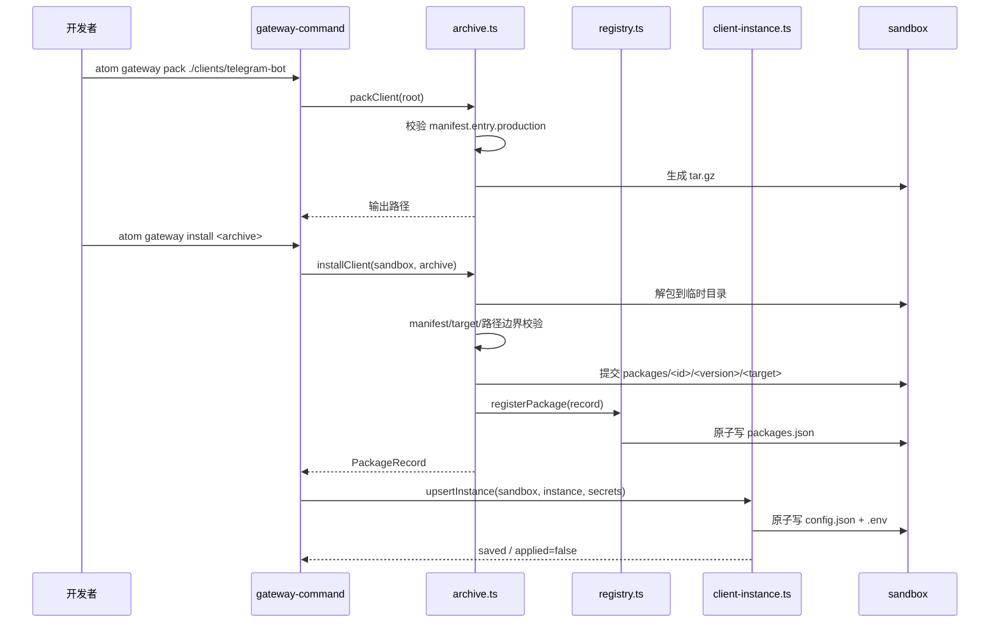

**失败语义**

- pack 失败不留半成品归档。
- install 失败不覆盖已有版本。
- 配置取消不创建实例。
- Gateway 离线时保存成功但 `applied=false`。

---

## 8. 在线重载：drain → replace → ready

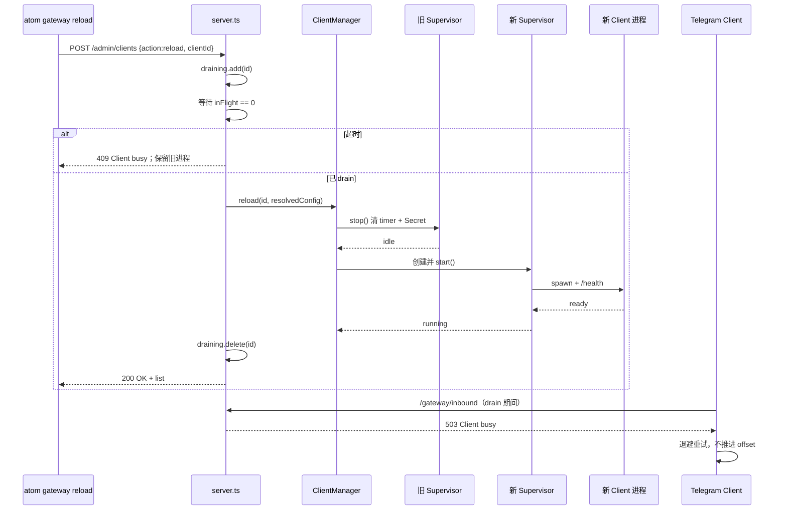

**并发不变量**

- reload / health failure / manual stop 都经过 supervisor 队列。
- 旧 Secret 撤销后不得恢复。
- 旧 exit 回调、旧 restart timer 不得影响新进程。
- 新进程启动失败只标记目标实例失败，其他实例继续。

---

## 9. 进程状态机（复用现有）

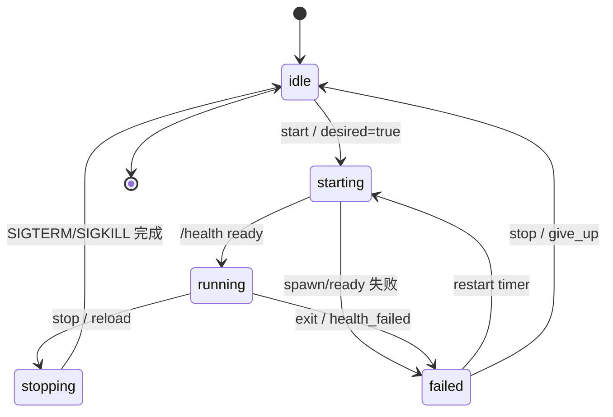

**新增约束**

- `draining` 是服务层状态，不进入进程状态机。
- 重载时旧 supervisor 走 `running → stopping → idle`，新 supervisor 从 `idle → starting`。
- 实例列表展示“已配置但未启动”时，状态为 `idle`，不能显示 `running`。

---

## 10. 诊断与日志

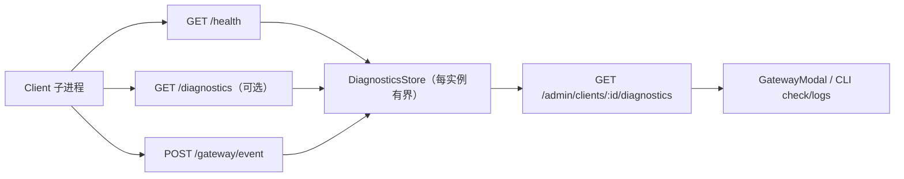

**判定规则**

| 展示项 | 来源 |
|---|---|
| 进程就绪 | supervisor 状态 + `/health` |
| 平台凭据 | Client `/diagnostics` 的 `telegram.getMe` |
| 消息往返 | 实际 inbound → task-result 成功，不由 `/health` 推断 |
| 最近错误 | DiagnosticsStore 的 `process/platform/delivery` 事件 |
| 未实现诊断的 Client | `/diagnostics` 404 → `unsupported` |

---

## 11. 文件改动热区

```mermaid
graph TB
    subgraph G1["G1 manifest / resolver"]
        F1["shared/config/client.ts"]
        F2["shared/config/client-instance.ts"]
        F3["gateway/client-package/manifest.ts"]
        F4["gateway/client-package/resolver.ts"]
        F5["gateway/client-manager/client-command.ts"]
    end

    subgraph G2["G2 包与安装"]
        F6["gateway/client-package/registry.ts"]
        F7["gateway/client-package/archive.ts"]
        F8["clients/telegram-bot/manifest.json"]
        F9["clients/telegram-bot/package.json"]
    end

    subgraph G3["G3 动态与重载"]
        F10["gateway/client-manager/index.ts"]
        F11["gateway/server.ts"]
        F12["gateway/client-manager/diagnostics.ts"]
        F13["bootstrap/cli.ts"]
        F14["bootstrap/gateway-command.ts"]
        F15["src/main.ts"]
        F16["clients/telegram-bot/src/gateway-client.ts"]
    end

    subgraph G4["G4 管理与诊断"]
        F17["config-tui/GatewayModal.tsx"]
        F18["config-tui/GatewayInstanceForm.tsx"]
        F18b["config-tui/SecretFieldInput.tsx"]
        F19["config-tui/gateway-status.ts"]
        F20["bootstrap/menu-flow.ts / menu-history.ts"]
        F21["bootstrap/gateway-actions.ts"]
        F22["shared/runtime-file.ts"]
    end

    G1 --> G2 --> G3 --> G4
```

**热区说明**

- G3 改动 Gateway 服务核心与 CLI 分流，回归面最大。
- G2 改动新目录与归档，安全测试优先。
- G4 主要影响 TUI，需 PTY 验收。
- G4 UI 通过 `gateway-status.ts` 读取 admin API；install/load/pack 通过 `gateway-actions.ts` 复用 CLI handler，不复制命令实现。
- 所有阶段都可能改 `docs/index.md` 和相关设计文档。

### 11.1 G4 UI 数据流

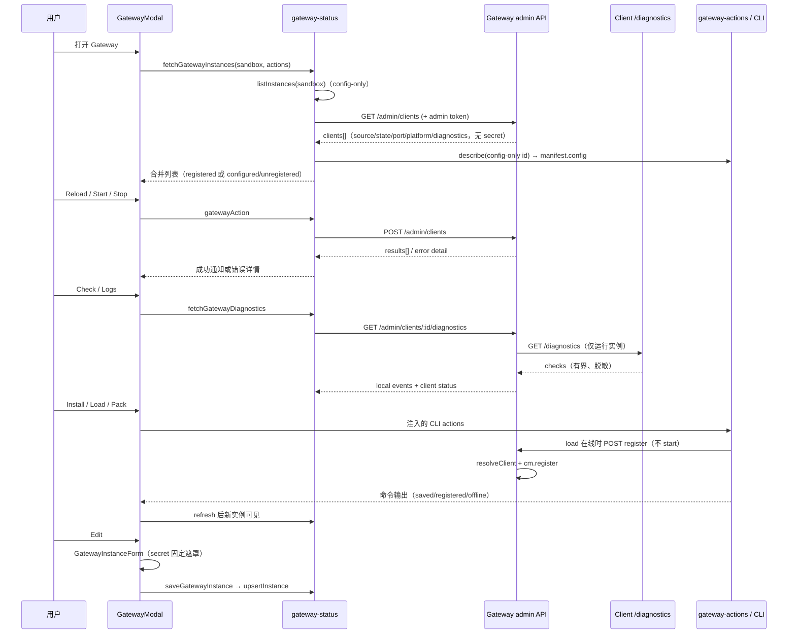

**关键边界**：

- `gateway-status` 的 admin 请求统一 `AbortSignal.timeout`（默认 5s）；超时显示明确错误，不无限等待。
- `register` 只创建 idle supervisor，不自动 start；进程状态仍来自 supervisor。
- client 列表 key 使用 `client:${id}`，固定动作 key（refresh/install/load/pack/port/back）与实例 ID 解耦。
- config-only 条目的进程字段是显式占位（`registered:false`、`state:"unregistered"`、`running:false`），不代表进程状态；进程状态仍只看 supervisor。
- `gateway list` 离线读 config；在线合并 admin 状态与 config-only，JSON 含 `configured`、`registered`、`offline`。

---

## 12. 测试关系

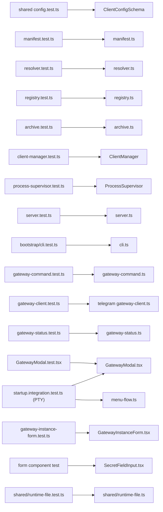

**测试替身**

- `spawn` / `fetch` / `now` / timer 使用 `client-manager/test-helpers.ts`。
- 包与配置测试使用 `mkdtemp` 临时 sandbox。
- M1 集成测试 `client-package/integration.test.ts` 用 resolver + `ClientManager` + fake runtime 覆盖 package、directory、旧 binary 拒绝、凭据隔离与保留参数；不启动真实进程。
- Telegram 测试注入 fake fetch，不访问真实 API。
- 进程级验收只在显式 `ATOM_RUN_STARTUP_VALIDATION=1` 时运行。

---

## 13. 片段索引

| 图示节点 | 代码片段位置 |
|---|---|
| `ClientConfigSchema` 二来源 | [code_and_file §2.1](./atom_neo_2026-11-14_gateway_client_packaging_code_and_file.md#21-srcpackagessharedsrcconfigclientts修改) |
| 实例写入 | [code_and_file §2.2](./atom_neo_2026-11-14_gateway_client_packaging_code_and_file.md#22-srcpackagessharedsrcconfigclient-instancets新增) |
| 子进程凭据过滤 | [code_and_file §2.4](./atom_neo_2026-11-14_gateway_client_packaging_code_and_file.md#24-srcpackagessharedsrcutilschild-process-envts修改) |
| 运行描述共享读取 | [code_and_file §2.5](./atom_neo_2026-11-14_gateway_client_packaging_code_and_file.md#25-srcpackagessharedsrcruntime-filets新增) |
| manifest | [code_and_file §3.2](./atom_neo_2026-11-14_gateway_client_packaging_code_and_file.md#32-manifestts新增) |
| resolver | [code_and_file §3.3](./atom_neo_2026-11-14_gateway_client_packaging_code_and_file.md#33-resolverts新增) |
| registry | [code_and_file §3.4](./atom_neo_2026-11-14_gateway_client_packaging_code_and_file.md#34-registryts新增) |
| archive | [code_and_file §3.5](./atom_neo_2026-11-14_gateway_client_packaging_code_and_file.md#35-archivets新增) |
| ClientManager 动态 | [code_and_file §4.3](./atom_neo_2026-11-14_gateway_client_packaging_code_and_file.md#43-client-managerindexts修改) |
| drain / reload | [code_and_file §5.1](./atom_neo_2026-11-14_gateway_client_packaging_code_and_file.md#51-serverts修改) |
| CLI 解析 | [code_and_file §6.1](./atom_neo_2026-11-14_gateway_client_packaging_code_and_file.md#61-srcbootstrapclits修改) |
| 命令处理 | [code_and_file §6.2](./atom_neo_2026-11-14_gateway_client_packaging_code_and_file.md#62-srcbootstrapgateway-commandts新增) |
| Telegram 入站 | [code_and_file §8.3](./atom_neo_2026-11-14_gateway_client_packaging_code_and_file.md#83-clientstelegram-botsrcgateway-clientts新增) |

> 锚点由 GitHub/Markdown 渲染器生成，若链接失效以章节标题为准。

---

## 13.1 G5 官方来源、升级与卸载流程

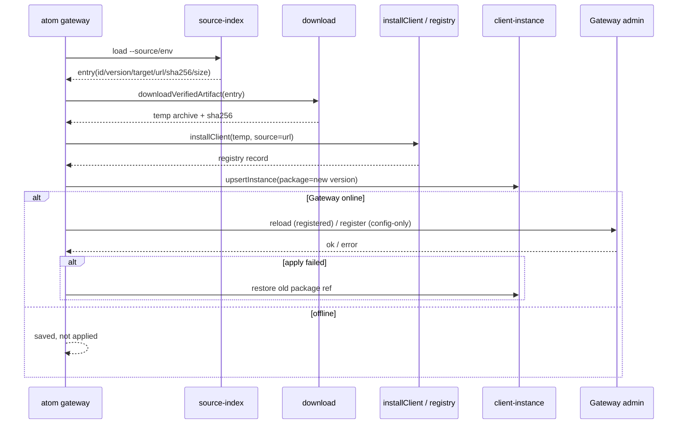

**卸载**：`removePackage(...,{removeFiles:true})` 在 registry 锁内检查实例引用；包目录先改名为临时路径，registry 写入成功后再删除临时目录。registry 写入失败恢复目录；删除失败返回残留路径。凭据与开发源码不在删除范围。

**发布**：`scripts/gateway-release.ts` 只接受当前 host target，调用 `packClient` 生成归档，计算归档 sha256/size，并要求 `--base-url` 生成索引条目；未构建 target 不写入索引。索引默认与已有文件按 `id@version/target` 合并，相同 URL+sha256 幂等，冲突拒绝。

**URL 边界**：远程索引/归档只允许 HTTPS；HTTP 仅 loopback。索引流式读取并执行 maxBytes。

**Reload 恢复**：新 supervisor 启动失败时，ClientManager 恢复旧 config 与旧 supervisor 并重新 start；旧版本也失败时报告双失败。升级 apply 失败因此同时恢复 config 与运行中的旧进程。

---

## 13.2 G6 收口与待验收边界

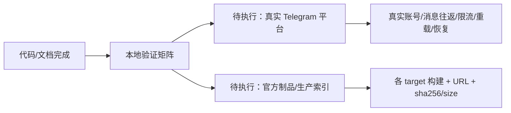

- 本地矩阵与真实平台清单见 [gateway-g6-validation.md](../records/gateway-g6-validation.md) 与 [telegram-platform-acceptance.md](../records/telegram-platform-acceptance.md)。
- 代码层已覆盖 drain `Retry-After: 1`、registry/config lock 指引、source/index/download 安全边界、reload 旧 supervisor 恢复。
- 不新增插件市场、权限沙箱、后台自动更新；多账号、exactly-once、完整 stdout/stderr、条件字段仍按 G6 范围冻结。

---

## 14. 架构不变量

> 以下为完整目标不变量。M1 已满足 1、2（实例配置）、3、5、6、7、8、9、10；第 4 条活动端口集合仍待 G3（M1 继续按启动数组下标分配端口）。

1. **单一启动描述**：所有 Client 最终都变为 `ResolvedClientConfig`，supervisor 不再理解 manifest。
2. **单一写盘入口**：Gateway 实例配置（`gateway.clients` / 实例凭据）只由本机 CLI/配置向导写入；Gateway 只读。
3. **单一进程生命周期**：spawn/stop/restart/health 仍由 `ProcessSupervisor` 拥有。
4. **单一端口所有者**：ClientManager 的活动端口集合，不按数组索引（G3）。
5. **单一 Secret 所有者**：supervisor 生成、撤销；重载后旧 Secret 不可恢复。
6. **平台检查与进程健康分离**：`/health` ≠ 平台凭据有效；消息往返必须单独记录。
7. **包与实例分离**：安装新版本不自动切换实例；删除包前检查引用。
8. **启动来源唯一**：实例只接受 `package` / `directory`；`binary` 配置明确拒绝，不自动迁移。
9. **无 shell 拼接**：入口数组、参数数组、cwd 直接传 `spawnProcess`。
10. **凭据不落地到包/日志/历史**：只存 `.env` 引用，子进程只注入目标实例。
11. **端口延迟绑定**：supervisor 在 spawn/restart 时读取当前 `config.port`，不使用创建时的临时 0。
12. **registry 写串行化**：read-modify-write 持有 `packages.lock`；锁等待有界，超时明确报错。

---

## 15. 待确认

- D1–D9 见 [plan §4](./atom_neo_2026-11-14_gateway_client_packaging_plan.md#g0-待确认决策)
- 如果 D4 改为 Gateway 代写配置，本节“单一写盘入口”与第 4 节依赖图需要同步调整。
- 如果 D6 改为新的会话隔离规则，需要新增迁移图与旧会话恢复图。
