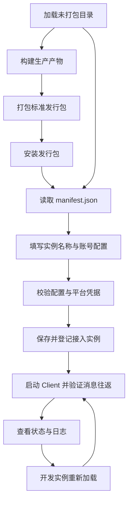

# Gateway Client 接入与发行规划

> 日期：2026-11-14，2026-11-15 修订。状态：**G0 决策已确认；M1（G1）、M2（G2）已实施；G3–G6 待实施**。
> 修订：启动方式不再兼容旧 `binary`，实例只接受 `package` / `directory` 两种来源。
> 本文记录本轮讨论的目标、确认契约和范围；任务拆分见 [开发计划](./gateway-development-plan.md)。当前实现以 [Gateway](./gateway.md) 为准，M1 已完成 manifest、resolver、实例配置与统一启动描述。

## 1. 目标与已确定方向

将平台接入收敛为「安装 Client 包 → 填写账号配置 → 检查连接 → 启用」，开发时支持「加载目录 → 修改源码 → 重新加载 → 打包发行」。

用户已明确的方向：

- Client 制作为标准发行包，通过安装命令添加接入。
- 开发模式借鉴 Chrome 扩展的目录加载、调试与重载流程。
- 描述文件统一命名为 `manifest.json`，放在 Client 根目录，优先保留最基础字段。

M1（G0+G1）已落地 §5 的 manifest v1、§6 的实例配置与凭据引用、以及统一启动描述；§7 的在线重载和 G2–G6 的命令/安装/诊断能力仍为**拟实施方案**，不能据此认为现有程序已经支持。确认结论与 M1 边界见 §9。

## 2. 当前基线与复用边界（2026-11-14，M1 前）

以 2026-11-14 工作区实现为基线：

| 位置 | 已有能力 | 本轮补齐方向 |
|---|---|---|
| `src/packages/shared/src/config/client.ts` | 共享 `ClientConfigSchema`，字段为 id/platform/binary/clientArgs/stdio | 改为包/目录二选一，移除 binary/platform，不保留旧配置兼容 |
| `src/packages/gateway/src/client-manager/index.ts` | ClientManager facade、按配置创建 supervisor、端口与心跳管理 | 支持动态登记与替换指定实例 |
| `src/packages/gateway/src/client-manager/process-supervisor.ts` | 单实例状态机、串行启停、健康检查、退避与 Secret 生命周期 | 所有重载继续走现有生命周期 |
| `src/packages/gateway/src/client-manager/client-command.ts` | 参数映射、保留参数、spawn options、就绪探测 | 增加入口数组、cwd 与实例凭据注入 |
| `src/packages/gateway/src/server.ts` | 本机管理启停、平台消息转发、平台事件日志 | 状态查询、诊断、登记、重载与在途消息协调 |
| `src/bootstrap/cli.ts` / `src/bootstrap/menu-flow.ts` | CLI 分流；菜单已有 gateway/run、start clients、stop clients | 增量接入新命令与菜单 |
| `src/packages/config-tui/src/components/GatewayModal.tsx` | 只编辑 Gateway 端口 | 升级为平台接入列表与配置向导 |
| `clients/telegram-bot/package.json` | Bun 源码入口与编译二进制命令 | 首个标准包与开发目录样例 |

继续使用共享 `HttpServer`、`spawnProcess` 和 `createChildProcessEnv`，兼容 Atom 的 Bun/Node 运行入口。Telegram 源码目前仍依赖 Bun；Atom 在 Node 下运行不代表开发 Client 自动变成 Node 程序。

保留本机管理认证与平台 Client Secret 的隔离；Core 任务调度与平台 HTTP 消息契约保持兼容。实例配置是破坏性替换：旧 `binary` 配置不再接受，需重新登记为包或目录实例。不为一个平台另建通用插件执行框架。

## 3. 三类对象

| 对象 | 标识示例 | 所有内容 |
|---|---|---|
| Gateway 服务 | 当前 sandbox 的运行实例 | Core 地址、本机管理入口、进程管理 |
| Client 程序包 | `telegram-bot` + `0.1.0` | manifest、运行程序、配置字段声明 |
| 接入实例 | `telegram-main` / `telegram-dev` | 包或目录引用、账号参数、凭据引用、启停状态 |

包 ID 稳定且与名称分离；实例 ID 在 sandbox 内唯一。同一个包可以供多个实例引用，每个实例显式选择版本或开发目录。安装新版本不自动切换全部实例，开发目录也不静默替换发行包。

现有会话 ID 为 `platform:platformUserId`；不同 Client 发起者冲突会被拒绝。包复用不等于已支持同平台多账号的会话隔离，相关决策与验收必须在多账号交付前收口（见开发计划）。

## 4. 建议使用流程



以下均为**建议语法，当前未实现**；所有命令使用 `--sandbox` 选择目标，缺省规则复用现有 CLI。

```bash
# 本地包闭环优先交付；官方名称与 URL 获取在后续阶段接入
atom gateway install ./telegram-bot-0.1.0-darwin-arm64.tar.gz --sandbox ./sandbox
atom gateway install telegram --sandbox ./sandbox

# 开发目录原位加载；首次引导创建实例，重复加载不能覆盖其他实例
atom gateway load ./clients/telegram-bot --sandbox ./sandbox
atom gateway reload telegram-dev --sandbox ./sandbox
atom gateway logs telegram-dev --sandbox ./sandbox

# 先构建，再打包；pack 不自动执行 manifest 中的构建脚本
atom gateway pack ./clients/telegram-bot
atom gateway list --sandbox ./sandbox
atom gateway start telegram-main --sandbox ./sandbox
atom gateway stop telegram-main --sandbox ./sandbox
atom gateway check telegram-main --sandbox ./sandbox
```

安装和目录登记在 Gateway 离线时可完成，显示「已保存，未启动」；在线登记、启停与重载通过管理接口执行。控制命令不隐式启动 Core/Gateway，服务仍由 `--mode core-gateway` 或现有菜单 gateway/run 启动。首次交互配置取消时不创建半成品实例；非交互环境缺少必填配置时返回明确错误，不能挂起等待输入。

## 5. manifest.json 最小契约（v1，M1 已实现）

### 5.1 六个基础必填字段

| 字段 | 类型 | 规则 |
|---|---|---|
| `manifest_version` | integer | 第一版为 `1`；表示 Atom Client manifest 与对应基础通信契约版本 |
| `id` | string | 稳定包 ID，建议小写字母、数字、连字符；用作包引用与升级身份 |
| `name` | string | 非空展示名称 |
| `version` | string | 程序版本，第一版建议三段数字，如 `0.1.0` |
| `platform` | string | 非空平台标识，如 `telegram`；保持同一包版本间稳定 |
| `entry` | object | 至少包含 production/development 之一；每个入口是非空字符串数组 |

```json
{
  "manifest_version": 1,
  "id": "telegram-bot",
  "name": "Telegram Bot",
  "version": "0.1.0",
  "platform": "telegram",
  "entry": {
    "production": ["./bin/telegram-bot"],
    "development": ["bun", "run", "src/main.ts"]
  }
}
```

运行规则：

- 加载目录只选择 development，发行包只选择 production；所需入口缺失时明确报错，不自动回退。
- 以 Client 根目录作为 cwd。相对可执行路径相对该目录解析，`bun` 等裸命令按 PATH 查找；其余数组项原样传递。
- 直接传给共享 `spawnProcess`，不拼接 shell 命令、不展开 shell 变量。
- Gateway 在入口数组后追加现有 `--secret`、`--port`、`--gateway-url` 以及普通账号参数；入口或配置均不能覆盖内部保留参数。
- 开发源码不要求存在 production 产物，加载时只校验 development；pack/install 必须校验 production。
- 未知 manifest_version 拒绝加载；`1` 沿用既有 `/health`、`/task-result`、`/command` 与入站消息契约，新增可选诊断能力需明确兼容行为。后续确有独立演进需求再拆协议版本。

### 5.2 按需字段

| 字段 | 条件 | 用途 |
|---|---|---|
| `config` | Client 需要用户输入配置时必需 | 驱动安装向导、校验、默认值和凭据保存 |
| `target` | 包含原生可执行文件的发行包必需 | 系统与架构，如 `darwin-arm64`，安装时校验 |
| `description` / `author` / `homepage_url` / `icons` | 可选 | 展示信息，不影响基础加载 |

`target` 在源码加载时不限制开发主机；pack 按本次实际构建目标写入，不能将开发机架构当作交叉编译产物的架构。第一版原生包按目标分别发行。

### 5.3 配置声明与凭据（M1 已实现）

```json
{
  "config": {
    "bot-token": {
      "label": "Bot Token",
      "type": "string",
      "required": true,
      "secret": true,
      "env": "TELEGRAM_BOT_TOKEN"
    },
    "mode": {
      "label": "连接方式",
      "type": "string",
      "enum": ["longpoll", "webhook"],
      "default": "longpoll"
    }
  }
}
```

v1 优先覆盖现有字符串参数、required、enum、default、secret；普通字段键与 `clientArgs` 的 kebab-case 参数名对应。选择 webhook 后才展示相关高级字段；webhook 的条件必填最终仍由 Telegram Client 校验，不在 v1 引入通用表达式语言。

启动前校验 `required`：secret 字段必须在实例 `credentials` 中有引用；非 secret 字段必须在 `clientArgs` 中有同名参数。`default` 不会在启动时自动注入，`enum` 选择与 `default` 预填由 G2 配置表单负责。

`env` 是为 secret 字段补充的建议映射：manifest 只声明子进程使用的变量名，实际值存于目标 sandbox 的 `.env`。实例只保存字段到持久化变量名的引用，例如 `bot-token → ATOM_CLIENT_TELEGRAM_MAIN_BOT_TOKEN`；启动时解析该引用，并向该实例子进程注入 `TELEGRAM_BOT_TOKEN`。同一包的不同实例可使用相同子进程变量名、不同持久化变量名。

不能仅写 `.env` 后依赖父进程继承：现有 loader 只在 bootstrap 时加载。在线新增或重载必须重新读取目标凭据，清除其他实例的凭据，并继续通过 `createChildProcessEnv` 移除 `ATOM_ADMIN_TOKEN`。secret 字段不转换成普通 CLI 参数，不进入 manifest 默认值、日志、菜单历史或发行包。旧 clientArgs 中的凭据不自动迁移或删除。

## 6. 发行包与配置存储

建议第一版使用 tar.gz，归档根目录直接放 `manifest.json` 和 `bin/`，解包后不再猜测包装层级。开发目录可以额外保留源码与 package.json。

```text
telegram-bot/                     开发目录
  manifest.json
  package.json
  src/main.ts
  bin/telegram-bot                构建产物

$SANDBOX/
  config.json                     接入实例与版本/目录引用、普通配置、凭据引用
  .env                            每实例凭据
  .atom/gateway/
    packages/<id>/<version>/<target>/
      manifest.json
      bin/
    packages.json                 安装记录与来源（G2）
    state.json                    configRevision 等配置修订状态（D4）
    config.lock                   配置写入互斥锁；仅本机 CLI/向导持有
    logs/<instance-id>/            有限大小的实例日志
```

M1 已实现 `config.json` / `.env` 的单一写入入口 `shared/config/client-instance.ts`：写入前获取 `.atom/gateway/config.lock`，成功后递增 `.atom/gateway/state.json` 的 `configRevision`；失败或取消时恢复原文件，不留下半成品实例。凭据只写 `.env`，实例保存 `field -> ATOM_CLIENT_<ID>_<FIELD>` 引用。

第一版 pack 面向预构建的独立二进制，只收集 `manifest.json` 与 `bin/**`，排除源码依赖、`.env`、日志和运行数据；pack 按本次 target 写入归档 manifest，默认输出 Client 根目录下的 `dist/<id>-<version>-<target>.tar.gz`。pack 不安装依赖、不自动构建。development 入口可从打包后的 manifest 移除，生产加载不依赖源码或开发工具。

安装先校验 manifest、target、生产入口和解包路径边界，再从临时目录提交到版本目录；禁止路径越界与归档链接逃逸。失败不替换已有版本。registry 使用 `sha256` 内容标识：同内容幂等，同版本不同内容拒绝覆盖；卸载包前检查实例引用，不删除开发源码、账号凭据或会话数据。

实例配置继续归属用户配置。`gateway.clients` 只保留 `package` / `directory` 两种来源，二者互斥；`binary` 与实例级 `platform` 移除，platform、启动数组和 cwd 均由 manifest 解析。旧配置不自动迁移，升级后需重新登记。各实例显式固定安装版本。

`directory` 可为绝对路径；相对路径在 Gateway 启动时相对 sandbox 根目录解析。G2 的 CLI/向导应写入绝对路径，避免依赖进程 cwd。

在线配置变更需要配置修订校验与单一写入入口；CLI、配置向导和管理接口不得竞争覆盖 config.json/.env。具体提交/回滚顺序在开发阶段定义并验证。Gateway 端口变更仍需重启；现有 Core runtime overlay 继续拒绝 gateway 子树，不能通过放宽 overlay 实现 Client 重载。

## 7. 开发重载与可观测性

开发实例引用原始目录，不复制源码。首次加载登记目录和实例配置；重载重新读取 manifest、校验账号配置，并仅替换目标 Client，保留实例 ID、凭据引用与会话元数据。manifest.id/platform 改变按新包/新实例处理，不能覆盖旧身份。

重载复用 supervisor 操作队列：先校验 → 阻止目标实例接收新工作 → 等待已接受消息的结果投递结束 → 停止旧进程并撤销 Secret → 启动新进程并探测就绪。等待超时时返回忙/超时并保留原进程，不能先强杀再宣称重载成功；启动新进程失败则明确报告目标实例失败，不影响其他实例与 Core。开发源码修改不具备代码级自动回滚保证。

现有入站请求等待 Core 任务结束后才响应，Telegram 当前也缺少对入站 HTTP 失败状态的检查。开发前必须明确暂停/重试与在途计数契约，修复 Client 对拒收/忙响应的处理，不能把普通 stop/start 当作已完成安全重载。首版不承诺持久投递或 exactly-once。

| 展示项 | 判断来源 |
|---|---|
| 已配置、未启动 / starting / running / failed | 复用 supervisor，补充已配置但无进程的展示 |
| 平台连接未知 / 检查通过 / 故障 | Client 提供的有界诊断结果或认证事件，含检查时间 |
| 最近消息往返验证 | 实际接收消息并成功发送回复的证据，不由 `/health` 推断 |
| 最近错误、日志 | 实例级分类错误和脱敏输出；保留现有日志配置语义 |

开发者模式在平台接入管理中展示「加载目录」「重新加载」「打包」、源码路径和日志。首版手动重载；文件监听后续按需增加，并只由 Gateway 管理，避免 Client watch 与 supervisor 同时拥有重启职责。

## 8. 交付顺序与范围

第一轮交付 Telegram 的本地安装和目录开发闭环，再补齐官方名称下载、升级与卸载。平台接入列表统一管理包来源、实例配置、检查与启停；端口、可执行路径与 webhook 参数归入高级设置。保留已有 `--mode` 与菜单入口，新命令是增量入口。

官方来源映射、下载校验与多平台制品单独交付；不在首轮引入插件市场、权限沙箱、通用热更新框架或新消息队列。现有 HTTP 适配器、配置校验与生命周期职责优先复用。

## 9. G0 决策结论与 M1 实施范围

2026-11-15 用户确认 D1–D9 全部采用推荐方案：

| 编号 | 结论 |
|---|---|
| D1 | manifest v1 严格拒绝未知字段；新增字段提升 `manifest_version` |
| D2 | 实例配置单一对象 + `superRefine`，`package` / `directory` 恰好一个；移除 `binary` / `platform` |
| D3 | `.atom/gateway/packages.json`，`{version:1, packages:{id:{version:PackageRecord}}}` |
| D4 | 仅本机 CLI / 配置向导写配置；lockfile + `.atom/gateway/state.json` 的 `configRevision`；Gateway 只读 |
| D5 | 每实例在途计数；drain 期间 503；默认 30s 超时，超时保留旧进程 |
| D6 | 首版保持 `platform:platformUserId` 与冲突拒绝；多账号另行设计迁移 |
| D7 | `atom gateway <install\|load\|reload\|list\|start\|stop\|check\|logs\|pack\|uninstall>`；保留 `--mode gateway`；部分失败退出码 1 |
| D8 | 默认 `./dist/<id>-<version>-<target>.tar.gz`；新增 `tar` 依赖，禁止 shell 拼 tar |
| D9 | 可选 `GET /diagnostics`；未实现返回 404 显示 `unsupported`；`/health` 不等于凭据有效 |

M1（G0+G1）实际交付：

- shared 实例 schema（包/目录二选一、凭据引用、旧 `binary` 拒绝）、`client-instance` 读写与 revision、manifest v1、resolver、凭据 env 隔离、`ResolvedClientConfig` 启动链路和 fake runtime 测试。

M2（G2）实际交付：

- Telegram manifest 与 `bin/telegram-bot` 构建；tar.gz pack 白名单、target 注入、敏感文件排除。
- 安全 install：路径/链接/类型校验、临时目录、target/production 校验、失败回滚。
- `packages.json` registry 与 `sha256` 幂等/冲突；resolver 只使用 registry 登记的包路径，并校验 target 与当前 host 一致。
- 离线实例配置 API 与 config-tui 首次实例表单；临时 sandbox 端到端测试。
- CLI/TUI 在线入口、动态重载与诊断仍属 G3–G4，尚未实现。

## 10. 依据与关联文档

- [Chrome Manifest 格式](https://developer.chrome.com/docs/extensions/reference/manifest)：根目录 manifest.json，以及 manifest_version/name/version 的基础命名；Atom 自有格式和版本不等同 Chrome 格式。
- [Chrome 本地加载与重载流程](https://developer.chrome.com/docs/extensions/get-started/tutorial/hello-world)：借鉴目录加载、重载及日志调试的反馈流程。
- [Gateway 当前设计](./gateway.md)、[开发计划](./gateway-development-plan.md)、[Telegram 当前实现](../clients/telegram-bot.md)。
- [配置系统](../subsystems/configuration.md)、[启动菜单](../subsystems/startup-menu.md)、[Sandbox](../subsystems/sandbox.md)。
