# Atom Neo — Menu 与 Config 整合：关系图

> 项目：`atom_neo`
> 日期：2026-11-19
> 开发目标：`menu_config_integration`
> 状态：**M1–M5 已实施**
>
> 计划见 [plan](./atom_neo_2026-11-19_menu_config_integration_plan.md)，文件与示例代码见 [code_and_file](./atom_neo_2026-11-19_menu_config_integration_code_and_file.md)。

---

## 1. 系统上下文

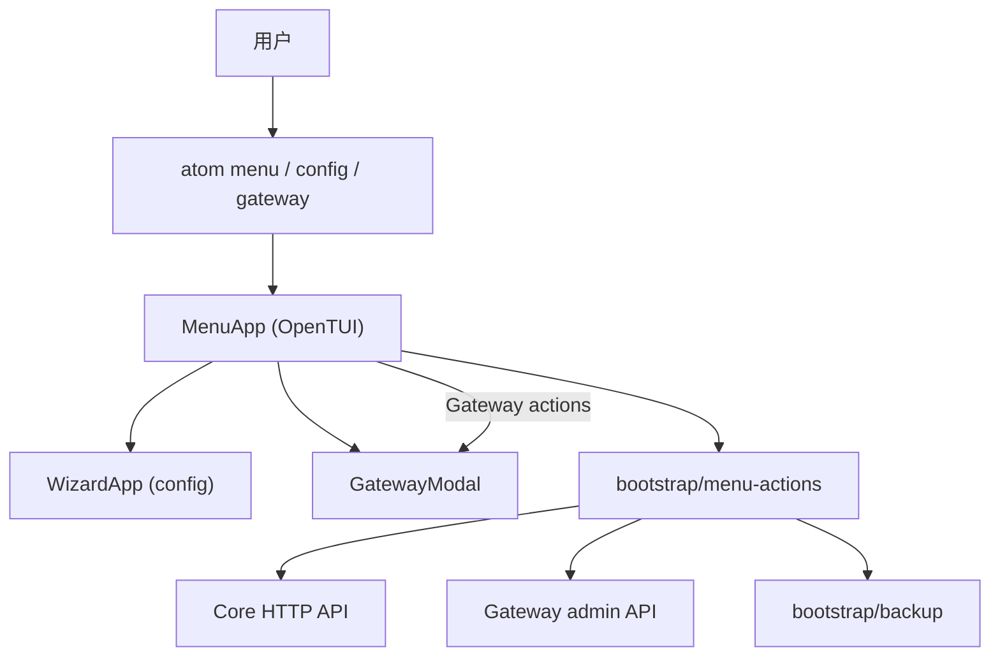

---

## 2. CLI 路由

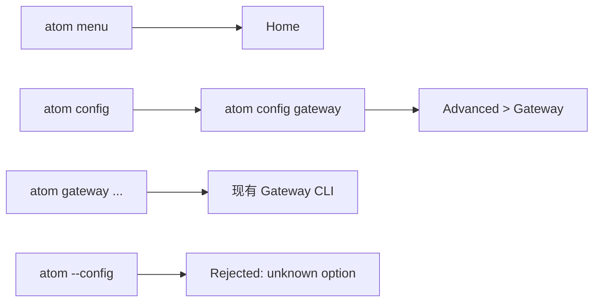

---

## 3. MenuApp 路由状态

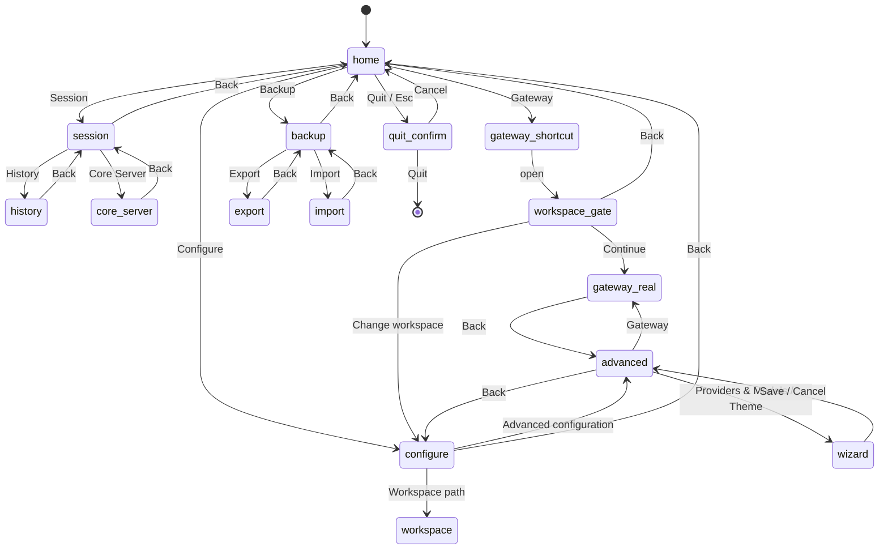

---

## 4. 模块依赖

```mermaid
graph TB
    subgraph ConfigTUI["@atom-neo/config-tui"]
        MenuApp["menu/menu-app.tsx"]
        MenuRoutes["menu/menu-routes.ts"]
        MenuTypes["menu/menu-types.ts"]
        MenuFrame["menu/menu-frame.tsx"]
        StartMenu["menu/start-menu-app.tsx"]
        Home["menu/menu-home.tsx"]
        WorkspaceGate["menu/workspace-gate.tsx"]
        SessionView["menu/session-view.tsx"]
        HistoryView["menu/history-view.tsx"]
        CoreView["menu/core-server-view.tsx"]
        BackupView["menu/backup-view.tsx"]
        Wizard["components/WizardApp.tsx"]
        StandaloneWizard["app.tsx"]
        GatewayModal["components/GatewayModal.tsx"]
        InstanceForm["components/GatewayInstanceForm.tsx"]
        Status["gateway-status.ts"]
        TuiKit["@atom-neo/tui-kit"]
    end

    subgraph Bootstrap["src/bootstrap"]
        StartMain["main.ts"]
        MenuLaunch["menu-launch.ts"]
        MenuActions["menu-actions.ts"]
        GatewayActions["gateway-actions.ts"]
        Backup["backup.ts"]
        Runtime["runtime-file.ts"]
    end

    subgraph Core["@atom-neo/core"]
        Router["http-router.ts"]
        Store["session/store.ts"]
        Sessions["session/persistence-service.ts"]
        Server["server.ts"]
    end

    StartMain --> StartMenu
    StartMain --> MenuLaunch
    StartMenu --> MenuApp
    MenuApp --> MenuRoutes
    MenuApp --> MenuTypes
    MenuApp --> MenuFrame
    MenuApp --> Home
    MenuApp --> WorkspaceGate
    MenuApp --> SessionView
    MenuApp --> HistoryView
    MenuApp --> CoreView
    MenuApp --> BackupView
    MenuApp --> Wizard
    StandaloneWizard --> Wizard
    MenuApp --> GatewayModal
    MenuApp --> TuiKit
    GatewayModal --> InstanceForm
    GatewayModal --> Status
    Wizard --> GatewayModal: 明确允许的第二入口
    MenuLaunch --> MenuTypes
    MenuActions --> MenuTypes
    MenuActions --> GatewayActions
    MenuActions --> Backup
    MenuActions --> Runtime
    MenuActions --> Router
    Router --> Store
    Router --> Sessions
    Server --> Router
```

**边界**

- `config-tui` 不导入 `bootstrap`；动作通过 `MenuActions` 注入。
- `bootstrap` 可以导入 `config-tui`、`core` 和 `gateway`。
- `GatewayModal` 不直接读写 config；配置写入通过 shared `client-instance` / `gateway-actions`。
- `WizardApp` 作为独立路由复用，不复制 provider/model 表单。

---

## 5. `atom menu` 启动序列

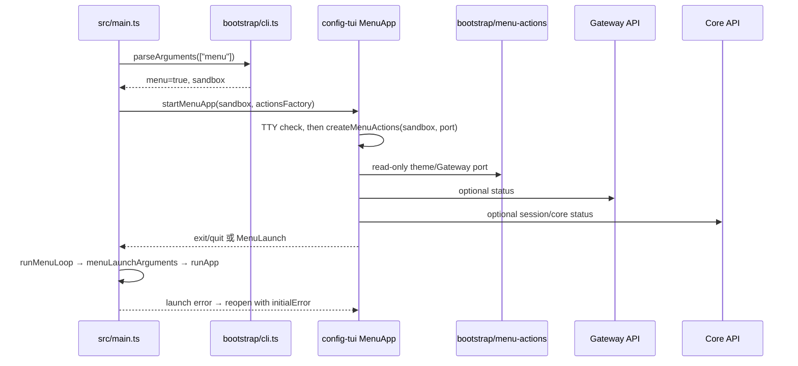

`MenuLaunch` 保留现有 `runApp` 执行路径：New Chat / Core Server / Attach 关闭 MenuApp 后由 `main.ts` 启动现有应用。失败 launch 不退出进程，而是重新打开菜单并显示 `Launch failed: ...`。

---

## 6. 顶级 Gateway 快捷入口

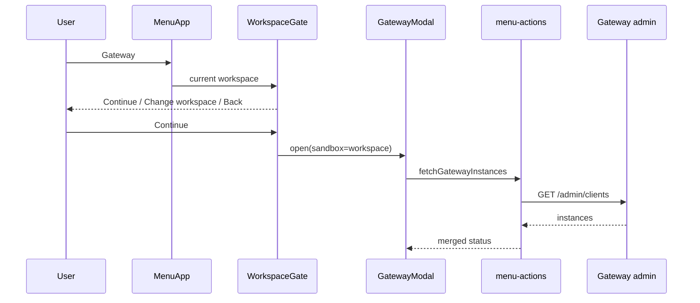

`Change workspace` 进入 `Configure → Workspace path`，保存后回到 `WorkspaceGate`。

---

## 7. 真实 Gateway 入口

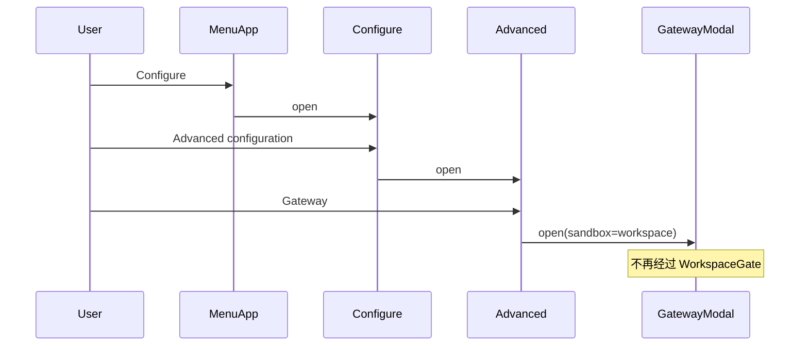

---

## 8. Session / History

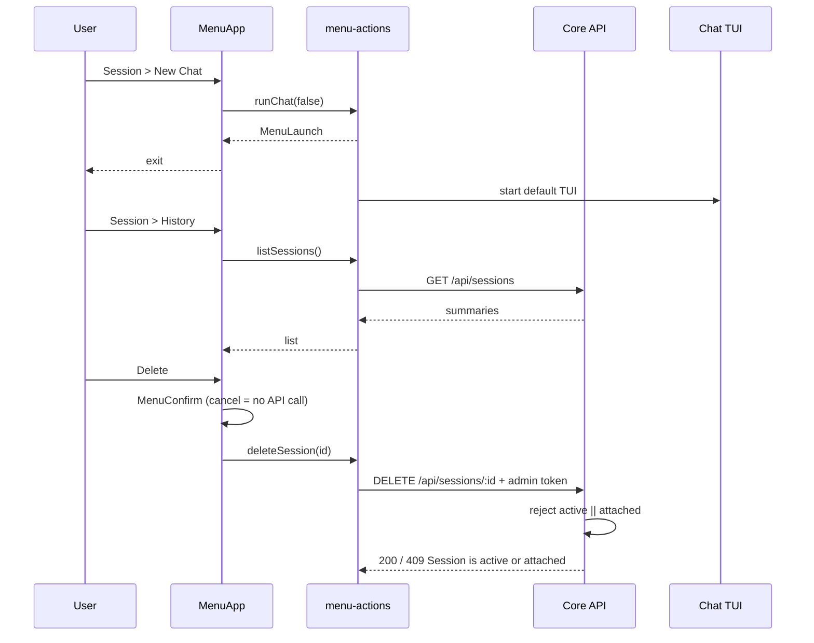

WS attach 生命周期：

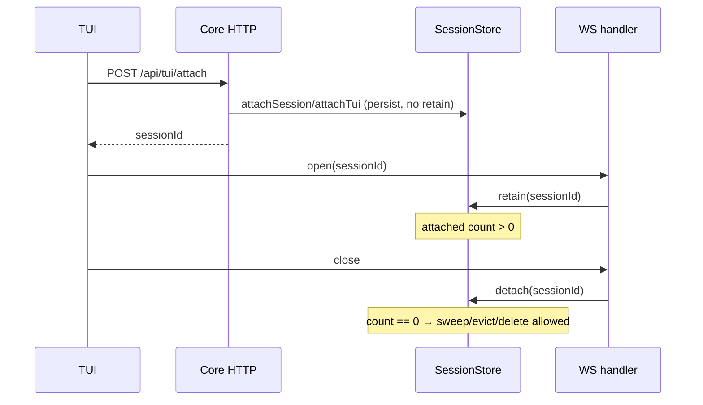

HTTP attach 失败（404/持久化 500）不会打开 WS，因此不会留下 attached。多个 WS 连接使用引用计数，最后一个 close 才释放保护。

---

## 9. Core Server Stop

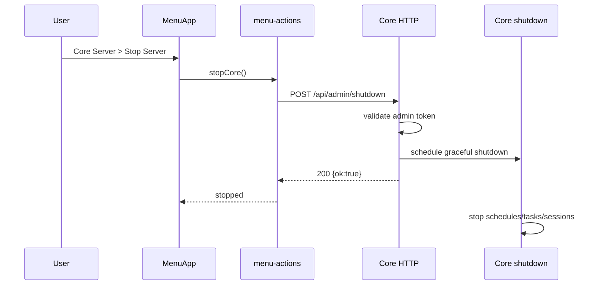

要求：

- 先返回响应，再关闭。
- 不直接 `kill`。
- 失败显示错误，不退出 menu。

---

## 10. Backup

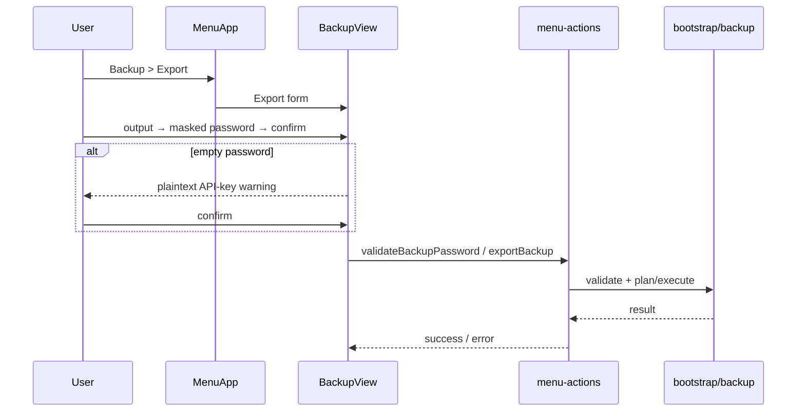

Import 先 `inspectBackupArchive`，只有加密归档显示遮罩密码；`.env` merge/replace 与覆盖确认后才写盘；取消不写文件。

---

## 11. 数据模型

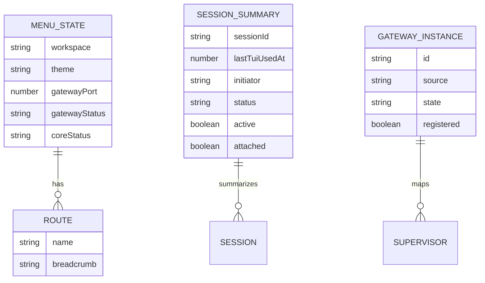

---

## 12. 文件改动热区

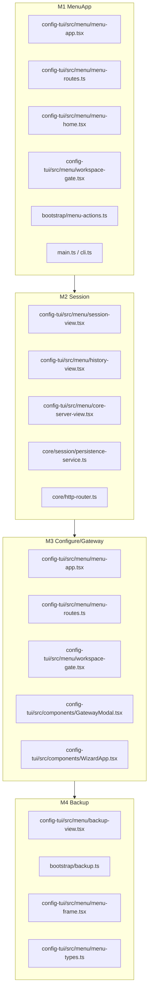

---

## 13. 测试关系

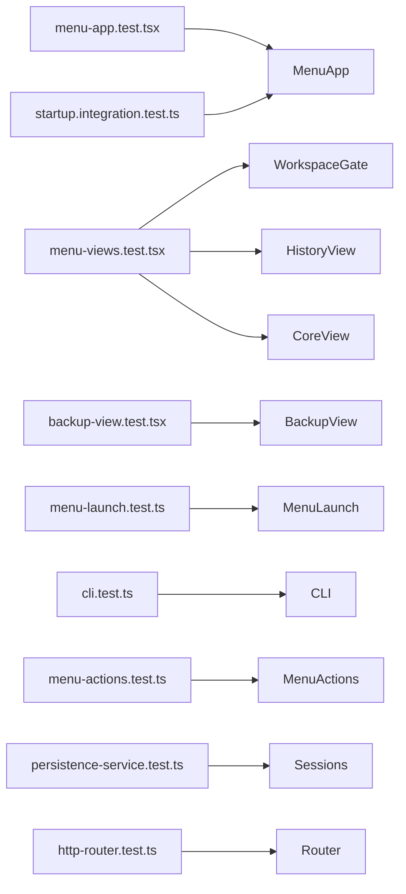

所有 UI 测试使用 fake `MenuActions`；不访问真实 Core/Gateway/Telegram。

---

## 14. 架构不变量

1. **单一 MenuApp**：menu 与 config 不再维护两套入口。
2. **单一 workspace**：Session、Gateway、Configure、Backup 使用同一个当前 workspace。
3. **真实入口唯一**：`Configure → Advanced → Gateway` 是真实 Gateway 配置入口。
4. **快捷入口有闸门**：顶级 Gateway 必须经过 WorkspaceGate。
5. **复用表单**：GatewayModal / GatewayInstanceForm / config wizard 不复制。
6. **无隐式启动**：安装/加载/保存不自动 start；启动需显式操作。
7. **状态来源唯一**：Gateway 进程状态来自 supervisor；平台检查来自 Client diagnostics。
8. **取消不写盘**：Back / Esc / Quit 取消不写 config、.env、history。
9. **CLI 一致**：`atom config` / `atom config gateway` 与 MenuApp 路由一致。
10. **非 TTY 安全失败**：无法启动 OpenTUI 时明确报错，不静默降级。

---

## 15. 已确认并实施

- [x] MenuApp 放在 `@atom-neo/config-tui`
- [x] `atom config` / `atom config gateway` 为唯一配置入口
- [x] 顶级 Gateway 强制 WorkspaceGate
- [x] `GET /api/sessions` 与受控 shutdown
- [x] WizardApp 作为路由级子页面复用
- [x] 审查修复：只读 config、Backup 密码、attached 保护、Session API admin、失败重试、长列表/长路径、PTY 覆盖
